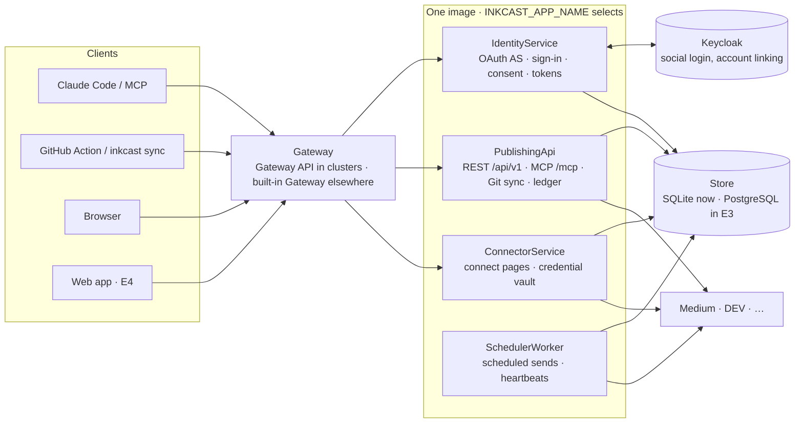

# Inkcast architecture

Inkcast is **one codebase that runs as several services**. Every service ships in the same image. `INKCAST_APP_NAME` picks which ones a process runs, and `All` (the default) runs them all, as the single-process server always did. The decisions behind this are in [ADR-0001](adr/0001-one-codebase-many-services.md) and [ADR-0002](adr/0002-gateway.md). For where a change goes and the rules tests enforce, see the [contributor map](contributor-map.md).

## Services

| `INKCAST_APP_NAME` | Full name (URL prefix, k8s name) | Owns | Public paths |
|---|---|---|---|
| `IdentityService` | `identity-service` | OAuth 2.1 authorization server, sign-in (Keycloak/OIDC, GitHub, password), consent, personal access tokens | `/.well-known/oauth-authorization-server`, `/authorize`, `/token`, `/register`, `/revoke`, `/auth/*`, `/tokens/*`, `/api/v1/tokens*` |
| `PublishingApi` | `publishing-api` | posts, previews, Git publishing (stories sync, ledger), REST API and docs, MCP endpoint | `/mcp`, `/.well-known/oauth-protected-resource*`, `/api*` |
| `ConnectorService` | `connector-service` | one-time connect pages, the encrypted credential vault | `/connect/*` |
| `SchedulerWorker` | `scheduler-worker` | sends scheduled posts, safe retries, heartbeats, housekeeping | none (probes and metrics only) |
| `Gateway` | `gateway` | routes public paths to services by the route table | everything above |
| `All` | `inkcast` | the four product services in one process | everything |

- **Prefixes.** `INKCAST_PATH_PREFIX` serves a process at `/` (default), under `/<full-name>` (`auto`), or under any path.
- **Stable paths.** The public paths above never change with the split. They come from one route table, `libs/contracts/routes.py`, which drives the built-in Gateway, the generated Gateway API HTTPRoutes and each service's spec.

## Layers

| Layer | Package | Rule |
|---|---|---|
| Entry | `launcher.py`, `cli.py` | Parse the command, validate config for the chosen services (exit 78 on a problem), build the context, serve |
| Services | `services/<name>/` | Each one exposes `SERVICE: ServiceSpec`, and never imports another service |
| Contracts | `libs/contracts/` | API models, the OpenAPI document and the route table: the only thing clients and services agree on |
| Shared libraries | `libs/` (config, secrets, observability, auth, db, content, platforms, http, pipeline, runtime) | Reusable, and never imports a service |
| Plug-ins | `inkcast.platforms`, `inkcast.services` entry points | Platforms and services can come from other packages |

| Module | Responsibility |
|---|---|
| `libs/auth` | `TokenVerifier` turns an OAuth access token or a personal access token into a `Principal` (user, scopes, kind). REST (`Authed`) and MCP tools check a scope on every call. |
| `libs/db` | One `Database` with domain repositories (`IdentityRepo`, `VaultRepo`, `PostsRepo`, `LedgerRepo`), each owned by one service ([ADR-0003](adr/0003-data-store.md)). |
| `libs/content` | Platform-neutral story: front matter, per-platform overrides, image URL fixing, schedule validation. Pure, with no I/O. |
| `libs/platforms` | The `Platform` interface (`prepare` is pure; `publish`, `update` and `find_existing` do I/O, with `capabilities`), the built-ins and the registry. |
| `libs/pipeline` | Fan-out to platforms, sends, safe retries (`60s`, `5m`, `30m`), updates, confirmation of unconfirmed sends, cancel. |
| `libs/http` | App composition and prefixes, probes, REST auth and problem+json errors, the HTML pages (strict CSP), and Swagger UI/ReDoc from vendored, hash-locked bundles. |
| `libs/observability` | JSON logs with a `service` field; the Redactor masks tokens and keys in every line; Prometheus metrics. |
| `libs/secrets` | `SecretValue`, `SecretsProvider`, `Sealer` (encryption at rest), token hashing. |

## Sign-in flow (what Claude Code does on `/mcp` → Authenticate)

1. `POST /mcp` without a token returns `401` with `WWW-Authenticate: Bearer resource_metadata=…`.
2. The client reads `/.well-known/oauth-protected-resource/mcp`, then `/.well-known/oauth-authorization-server`.
3. It registers itself at `POST /register` (dynamic registration).
4. It opens `/authorize` in the browser with PKCE. Inkcast stores a *pending* request and redirects to `/auth/login`.
5. The identity provider round-trip runs: Keycloak, GitHub or the password form, ending at `/auth/callback`.
6. The callback maps the identity to an Inkcast user (`upsert_user`) and shows the **consent page**, naming the client and its redirect host.
7. On approve, Inkcast issues a single-use code and redirects to the client. The client exchanges it at `/token` with the PKCE verifier.

## Security model

**Credentials and tokens**

- Platform credentials are encrypted with a Fernet key derived from `INKCAST_SECRET_KEY`. Rotating that key requires reconnecting platforms; a KMS-backed envelope is planned (issue 09).
- OAuth codes and access/refresh tokens are stored only as SHA-256 hashes.
- Access tokens last 1 hour and refresh tokens 30 days. A refresh revokes the whole token family.
- Personal access tokens (`ink_pat_…`) are stored as hashes, carry only the scopes they were created with, expire (90 days by default), and can't create or revoke tokens. A new token is shown once: in the API response, or on the `/tokens/new` page after a fresh sign-in. It never appears in an AI transcript ([ADR-0005](adr/0005-personal-access-tokens.md)).
- Platform keys never pass through the AI. `inkcast_connect` returns a one-time, 15-minute link instead. The key is verified against the platform before it is stored.

**Authorization**

- Consent is required for every authorization. Dynamically registered clients can't obtain tokens silently, which addresses the "confused deputy" risk in the MCP security guidance.
- Every REST route and MCP tool checks a scope against the caller's `Principal`, and every query is scoped to that user.
- Hosted mode refuses to start unless sign-in is restricted (role, email domain, org or user list), or open sign-up is enabled explicitly.

**Transport and pages**

- DNS-rebinding protection checks `Host` headers on `/mcp`. `INKCAST_PUBLIC_URL` must be `https` unless it is localhost.
- The built-in Gateway passes `Host` through unchanged so services can pin it, replaces client-supplied `X-Forwarded-*` headers, and caps request bodies at 10 MB.
- Pages send a strict Content-Security-Policy, `X-Frame-Options: DENY`, `Referrer-Policy: no-referrer` and `Cache-Control: no-store`.

## Cloud-native design

### Twelve-factor mapping

| Factor | How Inkcast does it |
|---|---|
| Config | Environment only. Secrets via `*_FILE`, so Kubernetes/OpenShift Secrets mount as files, never env vars. |
| Backing services | IdP, platform APIs and storage are attached resources, swappable by configuration (platform API URLs too). |
| Build, release, run | One image per commit, released by digest, configured per environment by Kustomize. |
| Processes | Stateless web tier (OAuth state, tokens and posts live in the store). SQLite in v0.1 pins one replica; Postgres lifts it. |
| Port binding | `:8787` app, `:9090` metrics + probes. |
| Concurrency | Each service is its own process type (`INKCAST_APP_NAME`), and scales on its own. Claiming due posts is atomic, so several schedulers are safe. |
| Disposability | SIGTERM stops intake, lets in-flight requests finish (25 s grace) and **finishes the current scheduler tick**, so no post is half-sent. |
| Logs | JSON to stdout, no files. OAuth codes never logged (HTTP client and access logs held at WARNING). |
| Admin processes | `inkcast services`, `inkcast sync`; key rotation and migrations come later as one-off Jobs. |

### Runtime contract

| Probe | Path (metrics port) | Meaning |
|---|---|---|
| startup / liveness | `/livez` | Process is serving |
| readiness | `/readyz` | Storage answers; the scheduler (if this process runs it) ticked recently |
| metrics | `/metrics` | Prometheus text format, on a port that is never routed publicly |

**Metrics:**

- `inkcast_build_info`
- `inkcast_publish_total{platform,status}`
- `inkcast_scheduler_ticks_total`
- `inkcast_posts{status}`
- `inkcast_posts_due` (queue depth, ready for a KEDA scaler)
- `inkcast_posts_overdue` (scheduled posts past `INKCAST_OVERDUE_GRACE`; the scheduler is behind or stopped)
- `inkcast_sync_total{platform,action}`
- `inkcast_gateway_requests_total{upstream,code}`

**Pod security:**

- the container runs as an arbitrary non-root UID in group 0 (OpenShift `restricted-v2`, Kubernetes PSS `restricted`);
- read-only root filesystem; all capabilities dropped; seccomp `RuntimeDefault`;
- no service-account token.

**Duplicate-safe publishing:**

- Connection errors and 429s are retried.
- A timeout *after* a publish request was sent, or a 5xx on it, marks the post `unconfirmed`. Inkcast never retries it blindly: Git publishing asks the platform (`find_existing`) first, and anything else waits for a human.

### CNCF building blocks

Maturity as listed on cncf.io/projects (checked 2026-10-18); re-check before relying on it.

| Concern | Choice | CNCF status | Where |
|---|---|---|---|
| Orchestration | Kubernetes / OpenShift | Graduated | `deploy/kustomize` (overlays: openshift, kubernetes) |
| Packaging | Kustomize now; Helm chart planned | Helm: Graduated | issue 26 |
| GitOps | Argo CD or Flux | Graduated | `deploy/kustomize/environments`, issue 29 |
| Identity | Keycloak | Incubating | sign-in, admin portal |
| Ingress | OpenShift Route / Gateway API HTTPRoute | Gateway API is a Kubernetes SIG project | overlays |
| TLS | cert-manager | Graduated | Gateway certificates |
| Secrets | External Secrets Operator | Sandbox (2022) | `components/external-secrets` |
| Policy | Kyverno (image signature + SBOM verification) | Graduated | `deploy/policies` |
| Network | NetworkPolicy default-deny; Cilium FQDN egress or OVN EgressFirewall | Cilium: Graduated | base + `components/egress-*` |
| Metrics | Prometheus (ServiceMonitor) | Graduated | `components/servicemonitor` |
| Traces | OpenTelemetry | Graduated | issue 27 |
| Logs | stdout JSON → Fluent Bit / Fluentd | Fluentd: Graduated | platform logging |
| Autoscaling | KEDA on `inkcast_posts_due` / media queue | Graduated | social epic, issue 17 |
| Database | PostgreSQL via CloudNativePG | Sandbox (2025) | issue 10 |
| Object storage | Rook-Ceph RGW (on-prem) or cloud S3 | Rook: Graduated | social epic, issue 17 |
| Events | CloudEvents for webhooks in and out | Graduated | social epic, issue 19 |
| Supply chain | in-toto/SLSA provenance, Sigstore cosign, SPDX SBOM | in-toto: Graduated (Sigstore is OpenSSF) | `.github/workflows/publish.yml` |
| Runtime security | Falco | Graduated | optional, cluster-level |

### Deployment topologies

| Stage | Topology |
|---|---|
| Now (default) | One pod (`All`), SQLite on an RWO PVC, `Recreate` strategy |
| Now (split, CI and evaluation) | `components/split-services`: one Deployment per service plus the Gateway, sharing the SQLite volume on one node |
| E3 | Split services on PostgreSQL (CloudNativePG): HTTP services with ≥ 2 replicas, RollingUpdate, PodDisruptionBudget, topology spread; the scheduler scaled on `inkcast_posts_due` |
| Phase 2 | Media workers scaled by KEDA, object storage, CloudEvents webhooks (social epic) |

## Known limits

- **Storage:** SQLite. Split services share one volume on one node until PostgreSQL arrives (E3).
- **Platforms:** Medium can't edit or delete through its API. Git publishing reports changed Medium posts as `stale`. DEV unpublishing needs the platform UI. Inkcast cancels only what hasn't been sent.
- **Images:** they must be public URLs. Git publishing rewrites relative images to raw GitHub URLs. Uploading is planned.

---
<!-- inkcast-nav -->
[Docs](../docs/README.md) · [Licensing](../LICENSING.md) · [Legal](../legal/README.md) · [Contributing](../CONTRIBUTING.md) · [Security](../SECURITY.md) · [Inkcast README](../README.md)
