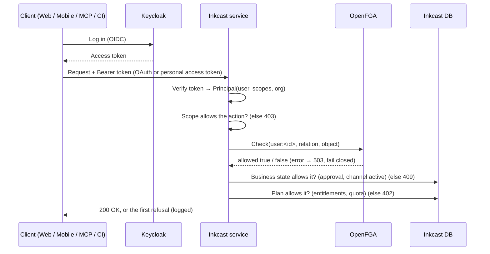

# Inkcast authorization design (Keycloak + OpenFGA)

> **Status:** accepted design, 2026-10-18. The owner's draft, refined, with Python examples. **Owner:** @ephico2real2
> **Delivery:** epic E3 (F3.5–F3.9) and E9 (F9.2, F9.5, F9.6). **Decisions:** [ADR-0006](adr/0006-identity-on-keycloak.md), [ADR-0007](adr/0007-openfga-authorization.md), [ADR-0008](adr/0008-keycloak-openfga-sync.md), [ADR-0009](adr/0009-authorization-identifiers.md).
> **Model:** [`authz/model.fga`](../authz/model.fga). **Tests:** [`authz/model.fga.yaml`](../authz/model.fga.yaml).

## 1. Goals

- **Deny by default.** No endpoint, job or MCP tool performs an action without an explicit authorization check.
- **One enforcement path.** Web, mobile, the public API, MCP and background jobs all call the same `authz.require()`.
- **Tenant isolation.** Companies and agencies only see the workspaces they're related to.
- **Explicit publish rights.** Publishing to a connected platform account (X, TikTok, Instagram …) is its own permission. It is never implied by "can edit".
- **Junior-safe.** The model is code, versioned in the repo, and tested in CI.

## 2. Who answers what

| Concern | Owner | Examples |
|---|---|---|
| Authentication (who are you?) | **Keycloak** | Login, MFA, OIDC tokens, Organizations |
| Authorization (can you do this to *this* thing?) | **OpenFGA** | Edit a post, approve a post, publish to a channel, manage billing |
| Business state | **Inkcast DB** | Post status (draft/approved/scheduled), plan and entitlements, quotas, channel paused |

Rules:

- **No resource permissions in JWTs.** Ask OpenFGA at request time. Tokens carry identity and coarse scopes, never plans or roles on resources.
- **OpenFGA is the only policy engine.** Keycloak Authorization Services are not used.
- **Business state is never stored as tuples.** Approval status, billing tier, entitlements and quotas live in the DB.

## 3. Request flow



The order matters:

1. **Authorization first**, so a caller without access learns nothing about state or plan.
2. **Plan last**, so an upgrade prompt is only shown to someone who could otherwise act.

Plan entitlements are designed in [E10](epics/E10-tiers-and-billing/design.md).

## 4. Authorization model

The model lives in [`authz/model.fga`](../authz/model.fga), schema 1.1. It is the owner's model with four refinements, all marked in the file:

1. `can_edit` = `editor from workspace or (author and viewer from workspace)`. An author removed from a workspace no longer edits their old posts.
2. `can_publish` = `publisher and viewer from workspace`. A direct publisher grant to someone outside the workspace isn't enough.
3. New relations for teams and tiers:
   - **On the organization:** `billing_admin` and `can_manage_billing`, `can_view_billing`, `can_manage_members`, `can_manage_security`, `can_view_audit`, `can_create_workspace`.
   - **On the workspace:** `client_reviewer` (for agencies), and `can_manage_members`, `can_manage_channels`, `can_create_post`, `can_create_token`, `can_view_usage`.
   - **Custom roles (Enterprise):** a `role` type, granted as `role:x#assignee` through dedicated relations (`role_manager`, `role_editor`, `role_reviewer`, `role_viewer` on a workspace; `role_publisher` on a channel). Adding a custom role is data, never a model change.
4. **Custom roles stay inside their organization.** A role grant counts only for members of the workspace's (or channel's) own organization (`role_editor and org_member`). A role from another organization, written by mistake, grants nothing. The member API also refuses such a write (E3.F3.8.S2): defence in two layers, because a model alone can't compare `role.org` with `workspace.org`.

| Type | Meaning |
|---|---|
| `organization` | A tenant: a company, an agency, or a person's personal organization. Its id is the Keycloak Organization id |
| `workspace` | A brand or publication inside an organization |
| `channel` | A connected platform account (e.g. the company's X account) |
| `post` | A draft or scheduled piece of writing |
| `role` | An Enterprise custom role |

### Roles as people see them

| Role (UI and pricing) | Relation | Billable seat? |
|---|---|---|
| Org owner / admin | `organization#owner` / `#admin` | yes |
| Billing admin | `organization#billing_admin` | free |
| Workspace manager | `workspace#manager` | yes |
| Editor (writer) | `workspace#editor` | yes |
| Publisher | `channel#publisher` | yes |
| Reviewer (approver) | `workspace#reviewer` | free |
| Viewer | `workspace#viewer` | free |
| Client reviewer (agency) | `workspace#client_reviewer` | free |

### Example tuples

| User | Relation | Object | Meaning |
|---|---|---|---|
| `user:alice` | `owner` | `organization:acme` | Alice owns Acme |
| `organization:acme` | `org` | `workspace:acme-blog` | The workspace belongs to Acme |
| `workspace:acme-blog` | `workspace` | `channel:acme-x` | The X account belongs to the workspace |
| `workspace:acme-blog` | `workspace` | `post:post-1` | The post belongs to the workspace |
| `organization:agency-x#member` | `editor` | `workspace:acme-blog` | Agency X's team can edit Acme's blog |

Granting an agency access is **one tuple**, and revoking it is deleting that tuple.

## 5. Model tests

[`authz/model.fga.yaml`](../authz/model.fga.yaml) holds the owner's five scenarios plus isolation, tier and agency cases:

- a removed author;
- an outside publisher;
- an agency without a grant;
- tenants listing each other's posts;
- a billing admin;
- managers versus editors versus reviewers;
- a client reviewer;
- a custom role;
- a custom role from another organization, wrongly granted (it must grant nothing).

Run the tests locally, and in CI (the `authz` job, which also checks that the compiled `authz/model.json` is current):

```bash
fga model test --tests authz/model.fga.yaml
```

## 6. Keycloak integration

- **Tenants are Keycloak Organizations.** A Keycloak Organization id is `organization:<id>` in OpenFGA. Every account gets a personal organization at first login (E9.F9.2.S2).
- **Users are `user:<inkcast user id>`**, never an email or username ([ADR-0009](adr/0009-authorization-identifiers.md)). The Inkcast id maps 1:1 to the Keycloak `sub` through the identity key `oidc:<issuer>#<sub>`. Other sign-in methods (GitHub, password) work the same way.
- **Org membership and admin changes sync** from Keycloak into tuples ([ADR-0008](adr/0008-keycloak-openfga-sync.md), E9.F9.5).
- **A scheduled job reconciles** Keycloak membership against OpenFGA tuples and fixes drift. A removed user loses access even if an event was missed.
- **Workspace-level grants are written by the Inkcast API, not Keycloak.** That covers manager, editor, reviewer, publisher and client reviewer, and goes through a transactional outbox (E3.F3.8).

## 7. Enforcement (Python, `inkcast.libs.authz`)

All checks go through one helper, and there are no direct engine calls anywhere else. The engine is pluggable: `INKCAST_AUTHZ_ENGINE=openfga` (the default; it calls OpenFGA's REST API through `httpx2`, with no SDK dependency) or `local`. The local engine is an in-process evaluator of the same compiled model, for tests, laptops and small air-gapped self-hosts. Both must pass the same `model.fga.yaml`.

```python
# libs/authz/__init__.py (E3.F3.6 / F3.7): the shape, not yet built
from typing import Protocol

class PolicyEngine(Protocol):
    async def check(self, user: str, relation: str, obj: Ref, *, consistency: str = "minimize_latency") -> bool: ...
    async def batch_check(self, items: list[tuple[str, str, Ref]]) -> list[bool]: ...
    async def list_objects(self, user: str, relation: str, type_: str) -> list[str]: ...
    async def write(self, writes: list[Tuple], deletes: list[Tuple] = ()) -> None: ...

async def require(principal: Principal, relation: str, obj: Ref, *, scope: str) -> None:
    """Scope AND OpenFGA must allow. Raises 403 (denied) or 503 (engine error; fail closed)."""
    if not principal.can(scope):
        raise ApiError(403, "insufficient_scope", f"This token lacks the `{scope}` scope.")
    user = f"user:{principal.user_id}"
    try:
        allowed = await engine.check(user, relation, obj)
    except EngineError:
        log.error("authorization check failed", extra={"event": "authz.error", "user": user, "relation": relation, "object": str(obj)})
        raise ApiError(503, "authz_unavailable", "Authorization is unavailable; nothing was changed.")
    if not allowed:
        log.warning("denied", extra={"event": "authz.denied", "user": user, "relation": relation, "object": str(obj)})
        raise ApiError(403, "forbidden", "You don't have permission to do that.")
```

Routes declare their permission, and an architecture test fails any route that declares neither a permission nor `public=True`:

```python
Route("/api/v1/channels/{channel_id}/publish",
      authed("posts:write", publish, permission=("can_publish", lambda req: Ref("channel", req.path_params["channel_id"]))),
      methods=["POST"])
```

MCP tools call the **same** `require()` on behalf of the authenticated user before doing anything:

```python
await require(principal, "can_publish", Ref("channel", channel_id), scope="posts:write")
```

Background work checks again at the moment it acts. The scheduler checks `can_publish` at send time, and Git sync checks per file and channel, so access revoked after scheduling stops the post.

A **personal access token never exceeds its user**: its scopes narrow what the user may do, and OpenFGA decides what the user may do now. A role change takes effect on the next request, with nothing to rewrite.

## 8. Operations

- **Deployment:** OpenFGA backed by Postgres, using the Kustomize component from E3.F3.9 (OpenShift restricted-v2). Run `openfga migrate` as a Job before upgrades. Images are mirrored for air-gapped registries.
- **Credentials:** the OpenFGA API credentials come from the secrets store, following the [secrets design](reference/secrets.md), never from committed env files. A NetworkPolicy lets only Inkcast services reach OpenFGA.
- **Model versions:** each deploy pins `INKCAST_FGA_MODEL_ID`. A model change ships as a new model version, written by `inkcast authz apply-model`, never edited in place.
- **Batching:** use `BatchCheck` for several checks in one request. List pages use `ListObjects` on **workspaces**, then filter in the DB, because `ListObjects` caps its results.
- **Consistency:** read-after-write checks (grant, then act) ask for higher consistency.
- **Logging and metrics:** every denied check and every engine error is logged with user, relation and object (ids only), and counted (`inkcast_authz_checks_total{relation,result}`). Errors and drift raise alerts (E7.F7.1.S2).

## 9. Contributor checklist

This list is also in the [definition of done](definition-of-done.md) and the PR template.

- [ ] A new endpoint or MCP tool calls `require()`, or declares `permission=…`. Public routes say `public=True`.
- [ ] No permission logic based on JWT roles for resource access.
- [ ] Model changes include new or updated tests in `authz/model.fga.yaml`, and the compiled `authz/model.json` is regenerated.
- [ ] Any API that writes tuples checks that both sides belong to the same organization (agency grants excepted, through their own API).
- [ ] `fga model test` passes in CI.
- [ ] New publish-capable features check `can_publish` on the channel, at request time **and** at send time.
- [ ] Plan limits are checked in the DB (`libs/entitlements`), never as tuples.

---
<!-- inkcast-nav -->
[Docs](README.md) · [Licensing](../LICENSING.md) · [Legal](../legal/README.md) · [Contributing](../CONTRIBUTING.md) · [Security](../SECURITY.md) · [Inkcast README](../README.md)
