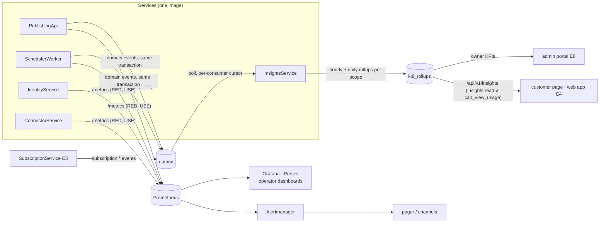

# Observability, KPIs and the data stack

**Status:** design, 2026-10-18 · **Epics:** E3 (PostgreSQL, Valkey), E7 (alerts, SLOs, channel health), E6 (operator KPIs), E4 (customer KPIs) · **Code:** `libs/cache`, `libs/events`, `libs/outbox`, `libs/kpi`, `libs/alerting`, `libs/dashboards`, `services/insights`

This document is the design behind the metrics, KPIs, alerts and the backing services Inkcast needs as a SaaS. It is written so that a reader who was not in the room can see **what** each layer measures, **where** the number comes from, **who** may see it and **which** service owns it. The rules in it are enforced by tests where a test can enforce them.

Figures for this document are produced with the diagram-kit (`/visual`) in the **light theme only**; the Mermaid sources below are the input.

## 1. The shape of the problem

Inkcast has four kinds of reader for numbers, and they must never share a data path by accident:

| Reader | Asks | Layer | Source of truth |
|---|---|---|---|
| An SRE or the owner on call | Is it up, is the queue moving, is a platform failing, is the API slow? | **system** | Prometheus metrics (RED, USE) |
| The owner and operators (admin portal, E6) | How is the business doing: sign-ups, activation, MRR, churn, platform health, cost? | **application** | domain-event rollups, billing events (E5), DB aggregates, OpenCost |
| A customer on their own page | How many posts went out, how many failed, on time, which repo synced, how close to my plan? | **customer** | domain-event rollups per organization and workspace, live counts from the owning tables |
| A team inside a customer organization | Who publishes what, who reviews, how long approvals take? | **team** | the same rollups with a `member` dimension, gated by OpenFGA |

The one rule that keeps the layers apart: **a customer id is never a Prometheus label.** Prometheus is for the fleet (a few thousand series per pod); per-customer numbers live in the database as rollups, and are read through an API that checks who is asking. A system that puts `org_id` on a histogram has a cardinality incident the day it gets its thousandth customer, and leaks tenant facts to anyone who can query the cluster's Prometheus.



## 2. Gaps this design closes (summary)

The full ranked review is in the gap review delivered with this design. The items that shape the code:

1. **No shared cache or coordination.** Rate limits, single-flight, idempotency and (soon) web sessions were per process. `libs/cache` adds a `CacheBackend` with in-memory and Redis/Valkey adapters; the rate limiter is distributed when a backend is configured and degrades to per-replica when it is not.
2. **No event stream.** Nothing could consume "a post was published" without polling the posts table. `libs/events` and the transactional outbox give every state change a fact other code can consume at least once, in order, idempotently.
3. **No KPIs at all.** `libs/kpi` holds the catalogue as code, a rollup engine and a `KpiStore`; `InsightsService` runs the consumer and serves `/api/v1/insights`.
4. **No alert rules, SLOs or runbooks in the repository.** `libs/alerting` is the catalogue; `scripts/gen-alerts.py` renders the `PrometheusRule`; `docs/runbooks/alerts.md` is linked from every alert, and a test keeps it so.
5. **No RED metrics per route, no queue lag, no cache ratio.** The HTTP middleware observes every request by route template; the scheduler observes schedule lag and the platform call; the store exposes head-of-line lag and outbox lag.
6. **No operator dashboard.** `libs/dashboards` generates the Grafana dashboard to the owner's `/dashboard` standard; the Perses form is produced from it.

## 3. The data stack

### 3.1 PostgreSQL (E3)

ADR-0003 already decides PostgreSQL via CloudNativePG, one schema per service, `FOR UPDATE SKIP LOCKED` for the queue, RLS on `workspace_id`. What this design adds:

- **The outbox and the KPI tables are ordinary tables in the owning schemas** (`outbox` next to `posts`, `kpi_rollups` in the insights schema), migrated with everything else. In PostgreSQL the outbox `seq` becomes a `BIGSERIAL`; the poller's `seq > cursor` read is index-only.
- **A read replica is not needed for KPIs**: rollups are tiny (one row per scope per hour per dim set). The insights reads touch `kpi_rollups` and two `GROUP BY` queries on the owner's tables, scoped by id, with the indexes already present (`posts_user`, the ledger primary key).
- **Backups:** CloudNativePG scheduled base backups plus WAL archiving to object storage (Rook-Ceph RGW on-prem, S3 in cloud), point-in-time recovery, a restore drill in CI each release (restore the latest backup into a throwaway cluster and run the end-to-end suite against it). Recovery objectives: RPO 5 minutes (WAL archive interval), RTO 30 minutes. The SQLite era has no backup story beyond volume snapshots; that is a P1 in the gap review.
- **Connection pooling:** PgBouncer in transaction mode from the CloudNativePG `Pooler` resource; the services keep one pool each.

### 3.2 Cache and coordination: Valkey or Redis

**What Inkcast needs from it** (all behind `CacheBackend`): GET/SET with TTL and NX, atomic INCR with expiry, one Lua script (the token bucket), DEL, PING. No streams, no modules, no search. Uses, in order of arrival:

| Use | Key pattern | Now | Later |
|---|---|---|---|
| Distributed rate limits on unauthenticated writes | `rl:<limit>:<client>` | shipped (`libs/http/ratelimit`) | per-token API limits (E5 plan limits) |
| Single-flight and read-through for platform lookups (destinations, `find_existing`) | `pl:<platform>:<hash>` | interface shipped | PublishingApi |
| Idempotency markers for `Idempotency-Key` and billing webhooks | `idem:<scope>:<key>` | DB table today | move to cache + DB record (E5) |
| Locks: credential refresh (E7 F7.2.S2), reconcile jobs | `lock:<name>` (SET NX PX) | — | E7, E3 |
| Web sessions for the BFF (ADR-0004) | `sess:<id>` | — | E4 |
| OpenFGA check cache (short TTL, keyed by tuple version) | `fga:<model>:<check>` | — | E3 |

**Licence and provenance.** Redis changed its licence in March 2024 (7.4: RSALv2 or SSPLv1, source-available) and added AGPLv3 as a third option with Redis 8 in 2025. Neither of the first two is OSI-approved, and AGPL has its own obligations for a hosted service. **Valkey** is the Linux Foundation fork of Redis 7.2.4 under **BSD-3-Clause**, the same licence Redis had for 15 years; it is drop-in for the protocol and commands Inkcast uses, it is what Red Hat ships in place of Redis in its recent platforms, and it is the choice for Inkcast: `INKCAST_CACHE_URL=redis://valkey:6379/0` (the scheme is the protocol's name, not the vendor's). Valkey is a Linux Foundation project, not a CNCF one; the CNCF landscape lists it under "database"; re-check the status before quoting it. For air-gapped clusters the image is mirrored like any other, and the operator of choice is the one the platform team already runs (Valkey has an upstream Helm chart and the Bitnami/OpenShift-compatible images run as non-root under `restricted-v2`).

**Why a hand-written RESP client** (`libs/cache/resp.py`): seven commands, one connection, no pipelines; RESP2 is a few dozen lines; the sandbox and the air-gapped targets cannot fetch a client library, and every dependency is one more licence check and mirror entry. The fake server in `tests/fakes.py` makes the adapter testable end to end without a Redis process. If Inkcast ever needs cluster mode, TLS client certificates or RESP3, replace the module with `redis-py` or `valkey-py` behind the same `CacheBackend`; nothing above it changes.

**Failure policy.** The cache is a *coordination* aid, never the source of truth. Every caller has a documented fallback: the rate limiter uses its in-process bucket (and logs `cache.backend.unavailable` once), a read-through calls the loader, a lock that cannot be taken is reported as "busy, try later". `inkcast_cache_errors_total` and the alert `InkcastCacheBackendErrors` make the degradation visible; readiness does not fail, because the product still works.

### 3.3 Queues and events

**The posts table stays the work queue.** It is durable, the claim is atomic, it scales with `SKIP LOCKED` in PostgreSQL, and `inkcast_posts_due` drives KEDA. A broker would add a component without removing the table (the post row is the state machine). What was missing is the **fact stream**: other parts of the system had to poll `posts` to learn anything. The transactional outbox (`libs/db/outbox.py`) fixes that:

- a `DomainEvent` is inserted in the same transaction as the row change (`PostsRepo.update_post(events=…)`), so there is never an event without the change or a change without the event;
- consumers read in `seq` order after their own cursor (`OutboxPoller`), hand batches to `EventSink`s, and advance the cursor after success: **at-least-once**, so every sink is idempotent by `event.id`;
- the event types are a catalogue (`EVENT_TYPES`), checked both ways by a test, like the log events;
- retention: rows every consumer has passed are purged once older than `INKCAST_OUTBOX_RETENTION_DAYS` (7 days by default, counted from when the event was written; housekeeping, §6).

Consumers today: `insights` (KPI rollups). Next: `webhooks` (E7 F7.4, CloudEvents out), `billing` (E5: metering from `post.published`), and a broker sink (NATS JetStream or Kafka) only when an external system needs the stream; at that point the broker is one more `EventSink`, and the outbox stays as the durable source. Media work (E8) gets its own queue table with the same claim pattern and KEDA on its depth; a broker is still not required.

### 3.4 Object storage for media (E8)

Rook-Ceph RGW on-prem, S3 in cloud, through one `ObjectStore` seam (put, presigned get, delete, lifecycle). Uploads go straight to storage with a presigned URL (the API never proxies bytes); derived renditions are written by the media worker; a lifecycle rule deletes originals 30 days after the last post that references them is published. Metrics: `inkcast_media_bytes_total{kind}`, `inkcast_media_jobs_due` (KEDA), `inkcast_media_job_duration_seconds`.

## 4. The metrics architecture, layer by layer

### 4.1 System and infrastructure (Prometheus)

**Source of truth:** the `/metrics` port of every pod (ServiceMonitor, 30 s), plus the platform's kube-state-metrics, kubelet and the operators' exporters for PostgreSQL (CloudNativePG `cnpg_*`), Valkey (`valkey_exporter` or the built-in `INFO` exporter), OpenFGA (`openfga_*`, native), Keycloak (`keycloak_*`, native since 24), the Gateway (the implementation's own; OpenShift Routes: HAProxy `haproxy_*`).

**What each service emits** (`libs/runtime.build_metrics`):

| Metric | Type | Labels | Answers |
|---|---|---|---|
| `inkcast_http_request_duration_seconds` | histogram | `route` (template), `method`, `code` (class) | RED for every route: rate, error ratio, p50/p95/p99 |
| `inkcast_publish_total` | counter | `platform`, `status` | publish attempts and outcomes |
| `inkcast_publish_duration_seconds` | histogram | `platform` | one platform call |
| `inkcast_publish_lag_seconds` | histogram | `platform` | how late a scheduled post was claimed |
| `inkcast_posts{status}`, `inkcast_posts_due`, `inkcast_posts_overdue`, `inkcast_posts_oldest_due_age_seconds` | gauge | `status` on the first | the queue: depth, overdue, head-of-line lag |
| `inkcast_posts_recovering_oldest_age_seconds` | gauge | — | how long the oldest post whose send was interrupted has been `recovering`, the platform refusing to say whether it arrived (`InkcastPostRecoveringTooLong` past an hour; `INKCAST_PUBLISH_RECOVERY_MAX_HOURS` ends it unconfirmed) |
| `inkcast_scheduler_ticks_total` | counter | — | the loop is alive |
| `inkcast_sync_total` | counter | `platform`, `action` | Git publishing outcomes |
| `inkcast_gateway_requests_total` | counter | `upstream`, `code` | the built-in Gateway |
| `inkcast_ratelimit_total` | counter | `limit`, `decision` | 429s by endpoint |
| `inkcast_cache_requests_total`, `inkcast_cache_errors_total` | counter | `backend`, `result` | hit ratio, backend health |
| `inkcast_outbox_pending`, `inkcast_outbox_oldest_age_seconds` | gauge | `consumer` | event stream lag |
| `inkcast_outbox_events_total`, `inkcast_kpi_events_total` | counter | `sink`, `result` | consumer throughput and failures |
| `inkcast_authz_checks_total` | counter | `relation`, `result` (allowed, denied, error) | permission decisions; errors mean 503s (fail closed) |
| `inkcast_authz_duration_seconds` | histogram | `op`, `engine` | one policy engine call (check, batch_check, list_objects, write, read) |
| `inkcast_build_info` | gauge | `version`, `platforms` | facts |

**Cardinality rules** (tests enforce the first two): the `route` label is a template from a closed list (`observability.route_label`; anything unknown is `other`), never a path; label values are closed sets (`status`, `platform` from the registry, `code` classes); no user, organization, workspace, token or ticket id ever appears on a metric. Budget: under 2,000 series per pod.

**USE for the backing services** comes from their exporters and is drawn on the same dashboard rows: PostgreSQL connections in use over max, transaction rate, replication lag, cache hit ratio, longest transaction; Valkey memory used over max, evicted keys, connected clients, command latency; OpenFGA check latency p95 and error rate; Keycloak login success and failure rates, token endpoint latency; the Gateway's requests and 5xx by route; kube CPU throttling, memory working set over limit, restarts, PVC usage.

**Traces (issue 27):** OpenTelemetry through `opentelemetry-api` only (already installed): a span per request from the middleware carrying `request_id`, a child span per platform call and per scheduler tick, context propagated to platform HTTP calls (`traceparent`), exported over OTLP to the cluster's collector (Tempo or the OpenShift distributed-tracing stack). The `MetricsExporter` seam: `Metrics.render()` is the Prometheus exporter; an OTLP exporter reads `Metrics.snapshot()` and the histogram state on a timer. Logs stay JSON on stdout with `request_id` and `trace_id` once tracing lands, so Loki can join the three.

### 4.2 Application KPIs (owner and operators; admin portal E6)

**Source of truth:** domain-event rollups at the `platform` scope (one row per platform per bucket, so the owner's view never scans customers), DB aggregates for "distinct" measures, **billing events from `SubscriptionService`** (E5) through the same outbox, and OpenCost for infrastructure cost.

| Group | KPI | From | Status |
|---|---|---|---|
| Growth | `signups`, `activation_rate` (connected a platform and published within 7 days), `active_publishers` (distinct users with a publish in the period), conversion to paid | `user.created` (E9), `post.published`, `subscription.*` (E5) | `active_publishers` built; the rest planned |
| Revenue | `mrr`, `arr`, `churn_rate`, `net_revenue_retention`, `arpa` | `subscription.changed`, `subscription.canceled`: SubscriptionService writes a `subscription_snapshots` row per organization per day; MRR is the sum of active snapshots, churn is the cohort that left, NRR compares a cohort's MRR twelve months apart | planned (E5) |
| Platform health | `platform_publish_success_rate`, `platform_unconfirmed_rate`, p95 schedule lag (Prometheus), sync outcomes, `channel_health` | rollups at `platform` scope; `inkcast_publish_lag_seconds`; `channel.state` (E7) | success and unconfirmed rates built |
| Cost | `credits_spent` (X and AI credits), `infra_cost` (OpenCost, allocated to the namespace, split by service label) | `credits.spent` (E8 / issue 21), OpenCost | planned |

**Aggregation:** streaming rollups from the outbox (seconds behind), not scheduled batch jobs, so the admin portal and the customer page read the same tables and agree. Revenue numbers are the one exception: they come from daily snapshots because a subscription's MRR is a state, not a sum of events.

### 4.3 Customer-facing KPIs (per organization and workspace)

**Source of truth:** rollups by scope (`user` now; `workspace` and `org` the moment E3 fills the ids on events, with no consumer change) plus live counts from the owning tables for "now" numbers (posts by status, ledger by status), which must not wait for a consumer.

| KPI | Built from | Grain | Shown as |
|---|---|---|---|
| Posts published, scheduled, retried, failed, unconfirmed, recovered, cancelled | `post.*` | hour, day; dims `platform`, `status`/`reason` | counts and a stacked time series |
| Publish success rate per platform | published / (published + failed + unconfirmed) | computed at read time from the three rollups | a rate with its numerator and denominator (never a bare percentage) |
| On-time rate, mean lag | `post.published` with `lag_seconds` ≤ 120 s (`ON_TIME_SECONDS`) | day | a rate and "average 14 s late" |
| Git sync activity | `sync.result` by `action` and `platform` | hour, day | a table of actions per repo and platform |
| Approval cycle time | `post.approved` (E4 F4.9) | day; dims `platform` | planned |
| Channel health | `channel.state` (E7 F7.2) | gauge | planned |
| Usage against plan limits | `libs/entitlements` counters (E5) | now | planned |
| Engagement | `engagement.sampled` read back from platform APIs (E8) | day | planned |

**Retention:** hourly buckets 90 days (`INKCAST_KPI_HOURLY_RETENTION_DAYS`, §6), daily buckets kept (one row per scope per KPI per day per dim set is a few hundred bytes a day per customer). Day buckets are UTC; a customer's local-day view is assembled from hourly buckets in the API, which is why hourly is kept at all.

**The API** (`services/insights/rest.py`; OpenAPI tag "Insights"; scope `insights:read`):

- `GET /api/v1/insights/summary?days=30`: live counts plus the period's rates and sync outcomes.
- `GET /api/v1/insights/kpis?names=posts_published,sync_results&grain=day&days=30`: time series, only KPIs whose `layer` is `customer` and whose aggregation is a sum (ratios are computed by the client or the summary); at most ten per request.
- With E3: `?scope=workspace:<id>` or `org:<id>`, and the composition rule from the authorization design applies in order: token scope ∧ `authz.require(principal, "can_view_usage", scope)` → 403; then the read. Team KPIs (`member_*`) require the workspace or organization scope: the engine never writes them at `user` scope, so a direct user read cannot return another member's numbers even by mistake. Audit-derived KPIs (`member_actions`) require `can_view_audit`.

### 4.4 Team KPIs inside a customer organization

Per member and per workspace: throughput (`member_posts_published`), Git activity (`member_sync_results`), approval latency and reviewer load (`member_approval_latency`, E4), contribution (`member_actions`, from the audit log, E3). They are the same events with a `member` dimension, written only at `workspace` and `org` scope.

**Privacy and visibility rules** (tie to the OpenFGA model in the authorization design):

| Who | May see | Relation |
|---|---|---|
| A member about themselves | their own rows in any workspace they belong to | `self` (the token proves it) |
| A workspace manager, an org admin or owner | every member's rows in that workspace / organization | `can_view_usage` on the workspace or organization |
| A reviewer or viewer | workspace totals, no per-member rows | `can_view_usage` false on member rows: the API drops the `member` dim and sums |
| A client reviewer (agency) | nothing about the agency's members; only the client workspace's totals | `client_reviewer` lacks `can_view_usage` |
| Platform operators | aggregates only; per-member rows only through the audit search with `can_view_audit` and a reason recorded | `inkcast-admin` realm role |

Additional rules: numbers about a person are shown with the person's display name, never a token id; a member removed from a workspace keeps appearing in historical buckets (facts do not change) but is labelled "former member"; exports of team KPIs are an audited action; GDPR erasure (§6) rewrites the `member` dim to a tombstone id.

### 4.5 Dashboards

Operator dashboards follow the owner's `/dashboard` standard: start from the questions, few metrics, the chart from the kind of data, fixed Tableau 10 colours, words on every panel, two panels to a row, legend below, generated from code and committed with the metrics that feed them, proved against the data source and in screenshots (light theme for figures). `libs/dashboards.py` is the generator for the platform dashboard; the Perses form for the OpenShift console is produced with the kit's `perses-dashboard` command and committed beside it. The next dashboards, in order: backing services (PostgreSQL, Valkey, OpenFGA, Keycloak; USE), the SLO board (error ratio over 1 h / 6 h / 3 d per SLO against its budget), and the business board from the KPI tables (Grafana's PostgreSQL datasource, read-only role, owner only).

Customer and team KPIs are not Grafana: they are React pages in the web app (E4) reading `/api/v1/insights`, with the same chart grammar (a count is a bar or a line from zero, a rate shows its parts, colour carries one thing).

## 5. Alerting and SLOs

**The catalogue** is `libs/alerting.ALERTS`: thirteen symptom alerts today (target down, scheduler stalled, posts overdue, queue head lag, unconfirmed publishes, publish failure rate per platform, HTTP 5xx rate per route, Gateway upstream unreachable, outbox consumer lag, cache backend errors, rate-limit surge, pod restarting, data volume nearly full). Each has a severity, a `service` label, a summary, a description and a runbook link; `docs/runbooks/alerts.md` has a section per alert, and a test fails on a missing one. `scripts/gen-alerts.py` renders the `PrometheusRule` component (`--check` in CI), included by the OpenShift and Kubernetes overlays.

**Severity and routing** (labels, not receivers; receivers belong to the cluster's Alertmanager):

```yaml
route:
  receiver: inkcast-warnings
  group_by: [alertname, service, slo]
  routes:
    - matchers: [team = inkcast, severity = critical]
      receiver: inkcast-pager          # PagerDuty / Opsgenie / an on-call channel
      repeat_interval: 1h
    - matchers: [team = inkcast, severity = warning]
      receiver: inkcast-warnings       # the ops channel
      repeat_interval: 12h
    - matchers: [team = inkcast, severity = info]
      receiver: inkcast-noise          # dashboards only
inhibit_rules:
  - source_matchers: [alertname = InkcastSchedulerStalled]
    target_matchers: [alertname =~ "InkcastPostsOverdue|InkcastQueueHeadLagHigh"]
    equal: [namespace]
```

**SLOs** (`libs/alerting.SLOS`, 30-day windows): API availability 99.9% (non-5xx on `/api/*` and `/mcp`), API latency 99% under 1 s, publish success 99% (attempts the platform accepted), schedule timeliness 99% (claimed within 120 s). Each gets recording rules for the error ratio over 5 m, 30 m, 1 h, 2 h, 6 h, 1 d and 3 d, and four **multiwindow, multi-burn-rate alerts**: 14.4x over 1 h with 5 m, 6x over 6 h with 30 m (both page), 3x over 1 d with 2 h and 1x over 3 d with 6 h (tickets). The error budget per SLO is on the platform dashboard; a burn alert's description says how many hours of budget remain at the current rate. Planned: a budget policy (freeze risky deploys when the 30-day budget is below 25%) once the SLO board has three months of data.

**What stays as log-based alerts** (Loki ruler, later): `config.unsafe` (exit 78 at rollout), `secrets.fetch.failed`, `auth.login.refused` bursts. Until Loki is in place, `InkcastPodRestarting` catches the first.

## 6. Retention, privacy and GDPR

| Data | Keep | Why |
|---|---|---|
| Prometheus | 15 days local; Thanos or the platform's long-term store for SLO windows | the 30-day SLO windows need 30 days of the recording rules |
| JSON logs | 30 days (platform logging); `request_id` only, never bodies or query strings | debugging; nothing personal beyond ids |
| Outbox rows | `INKCAST_OUTBOX_RETENTION_DAYS` (7; 1–30) from when written, once every consumer has passed them | replay window |
| Hourly KPI buckets and `kpi_applied` | `INKCAST_KPI_HOURLY_RETENTION_DAYS` (90; 31–400) | local-day views; `grain=hour` serves up to 31 days, so the floor is 31 |
| Daily KPI buckets | indefinitely, per scope | the customer's history; tiny |
| Audit log (E3) | 365 days on Business, 90 on Team, per plan | the tier design |

The two retentions are settings (F1.10.S3, issue #91), read into `Config.retention` and handed to `Store.purge_expired` by the scheduler's housekeeping (every 90 ticks); the defaults are the values above. The hourly retention may never be shorter than the outbox's: `kpi_applied` is purged at the hourly cutoff, and it is the record that stops an event replayed from the outbox counting twice, so it must outlive the events. The configuration refuses the reverse order, naming both variables. Production and staging state both explicitly.

Erasure (a user or an organization leaves): the owning tables are deleted by the existing flows; KPI rows at `user` scope are deleted; rows at `workspace`/`org` scope keep their totals and have `member` rewritten to a tombstone (`user:deleted`), because the organization's history is the organization's data. Events in the outbox are purged within `INKCAST_OUTBOX_RETENTION_DAYS` (7 by default, at most 30) by retention. Prometheus holds no personal data.

## 7. Seams and ownership

| Seam | Interface | Today | Later |
|---|---|---|---|
| `CacheBackend` | `libs/cache` | `MemoryCache`, `RedisCache` (RESP over asyncio) | a library client if cluster mode or RESP3 is needed |
| `MetricsExporter` | `Metrics.render()` / `Metrics.snapshot()` | Prometheus text | OTLP metrics (issue 27) |
| `KpiStore` | `libs/kpi/store.py` | `KpiRepo` (SQLite, then PostgreSQL in E3 behind the same class) | ClickHouse when rows per hour outgrow SQL |
| `EventSink` | `libs/events` + `OutboxPoller` | `RollupEngine` | webhooks (E7), billing metering (E5), a broker |
| `Notifier` | planned: `libs/notify` (`send(event, audience)`) | — | email (SMTP relay in the cluster; no outbound internet on-prem), signed webhooks, Slack/Teams via webhook URLs; the same catalogue of events, the same Redactor on every body |

**Service ownership.** `InsightsService` is a `ServiceSpec` from the same codebase: an HTTP service (`/api/v1/insights`) with a worker (the `insights` outbox consumer), runnable alone or inside `All`, with readiness on the consumer's last tick. **Rollups live in this one consumer rather than in the services that own the data**, because: the write path of PublishingApi and SchedulerWorker stays a write path (no analytics work in a request or a tick); bucket and idempotency logic exist once; cross-domain KPIs (approval cycle time joins posts and approvals; activation joins sign-ups and publishes) need one place anyway; the `KpiStore` can move to a columnar store without touching producers; and a bug in a rollup rule is fixed forward and replayed, never a data-loss event in the owner's table. The price is eventual consistency of seconds, which a KPI page accepts, and which the summary endpoint hides for "now" numbers by reading the owning tables directly.

`SubscriptionService` (E5) owns billing facts and emits them as events; `InsightsService` folds them into revenue KPIs; the admin portal (E6) reads them. `ConnectorService` will own channel health (E7) and emit `channel.state`.

## 8. Configuration

| Variable | Default | Meaning |
|---|---|---|
| `INKCAST_CACHE_URL` | (empty: in-process) | `redis://host:6379/0` or `rediss://`; Valkey or Redis |
| `INKCAST_CACHE_PASSWORD` / `_FILE` | | the `AUTH` password; a password in the URL is refused at startup |
| `INKCAST_INSIGHTS_INTERVAL` | `10` | seconds between consumer passes |
| `INKCAST_OUTBOX_RETENTION_DAYS` | `7` | days a domain event is kept in the outbox, counted from when it was written (the replay window); `1` to `30`. Purged once that old and every consumer has passed it |
| `INKCAST_KPI_HOURLY_RETENTION_DAYS` | `90` | days hourly KPI buckets and their `kpi_applied` rows are kept; `31` to `400`, never shorter than `INKCAST_OUTBOX_RETENTION_DAYS` (§6). Daily buckets are kept indefinitely |
| `INKCAST_OVERDUE_GRACE`, `INKCAST_SCHEDULER_INTERVAL`, `INKCAST_METRICS_PORT` | as before | |

## 9. Verification

- Unit: `tests/test_libs.py` (metrics registry, route labels, the RESP client against `FakeRedis`, the distributed rate limiter and its fallback), `tests/test_events.py` (outbox ordering, replay, consumers, the event catalogue), `tests/test_kpi.py` (the catalogue has a producer for every built KPI, bucketing, idempotency, team scopes, retention), `tests/test_alerting.py` (runbook sections, severities, expressions name registered metrics, burn-rate pattern, generated files current), `tests/test_dashboards.py` (the standard's rules).
- End to end, single and split mode: `test_insights_are_scoped_to_the_caller_and_come_from_rollups` publishes, syncs and cancels through the API, drains the consumer and reads the summary and the series, and proves another user sees nothing.
- Still to do before production: `promtool check rules` and `promtool test rules` on the generated file in CI (unit tests for every alert, as the owner's IPsec work does), a Valkey in kind for the split-mode suite, screenshots of the dashboard in both themes with every query run against the real data source.

---
<!-- inkcast-nav -->
[Docs](../README.md) · [Licensing](../../LICENSING.md) · [Legal](../../legal/README.md) · [Contributing](../../CONTRIBUTING.md) · [Security](../../SECURITY.md) · [Inkcast README](../../README.md)
