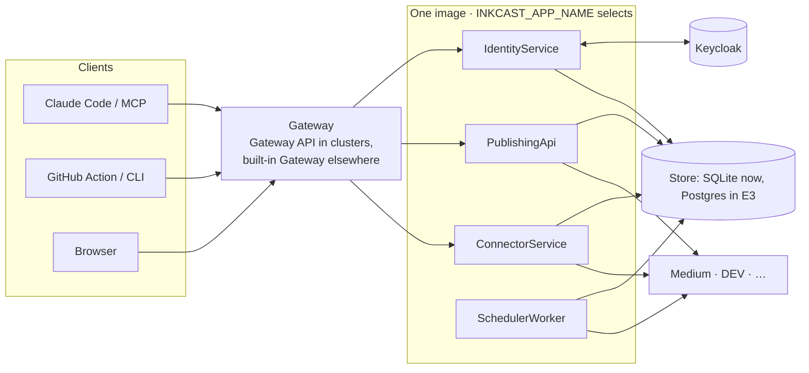

# E1 Platform foundations: design

## Goal

Turn the single Inkcast process into **services from one codebase**, each runnable on its own or all together, without changing what users see. Everything that follows (Git publishing, the web app, billing, admin) then lands in a structure that is already decoupled and safe for new contributors.

## Use cases

| Actor | Needs |
|---|---|
| Self-hoster | One container, one command (`inkcast`), as before |
| Operator | Scale or restart one part (the scheduler, sign-in) without the others; see which part is unhealthy |
| Contributor | Know where a change goes; be stopped by tests before breaking a boundary |
| Platform team | Deploy behind Gateway API, OpenShift Routes, or nothing at all |

## System design

**How a process starts.**
1. The launcher reads `INKCAST_APP_NAME`, resolves it to `ServiceSpec`s and validates config for just those services (`needs`). On a problem it exits 78.
2. It builds one `Context` (config, store, HTTP client, plug-ins, metrics) and composes the HTTP services into one ASGI app, at `/` or `/<full-name>`.
3. It starts workers and serves probes plus `/metrics` on the metrics port.

**How a request reaches a service.** The public route table (`libs/contracts/routes.py`) maps path prefixes to services, longest first. The built-in Gateway and the generated Gateway API HTTPRoutes both come from it. Services keep using public URLs (`INKCAST_PUBLIC_URL`) in everything they return, so clients never see internal paths.

**Who owns what.**

| Service | Owns | Public paths |
|---|---|---|
| IdentityService | OAuth AS, sign-in, consent, personal access tokens | `/.well-known/oauth-authorization-server`, `/authorize`, `/token`, `/register`, `/revoke`, `/auth/*`, `/tokens/*`, `/api/v1/tokens*` |
| PublishingApi | posts, previews, Git publishing, REST, MCP | `/mcp`, `/.well-known/oauth-protected-resource*`, `/api*` |
| ConnectorService | connect pages, credential vault | `/connect/*` |
| SchedulerWorker | scheduled sends, heartbeats, housekeeping | none (probes and metrics only) |
| Gateway | routing | everything above |

## Lessons applied

These are from the issue trackers of other publishing schedulers:

| Lesson | How E1 addresses it |
|---|---|
| Health checks were green while workers were dead | `/readyz` checks the store and that the scheduler ticked recently. A heartbeat row makes the scheduler's liveness visible to every process. The `inkcast_posts_overdue` gauge feeds an alert. |
| A dozen URL variables and opaque boot failures | One `INKCAST_PUBLIC_URL`. Config is validated per service with a readable list and exit 78; optional features never block boot. |
| One fat container running everything | One image, but each service runs alone by name. |
| Secrets leaking through error serialisers | The Redactor filters every log line. `SecretValue` hides secrets in reprs. |

## Risks

- **Shared SQLite in split mode.** Mitigated: pod affinity, one replica per service, `Recreate`. Production split waits for E3.
- **A service secretly depending on another's in-process state.** Mitigated: the full end-to-end suite runs split behind the Gateway, on every build.

---
<!-- inkcast-nav -->
[Docs](../../README.md) · [Licensing](../../../LICENSING.md) · [Legal](../../../legal/README.md) · [Contributing](../../../CONTRIBUTING.md) · [Security](../../../SECURITY.md) · [Inkcast README](../../../README.md)
