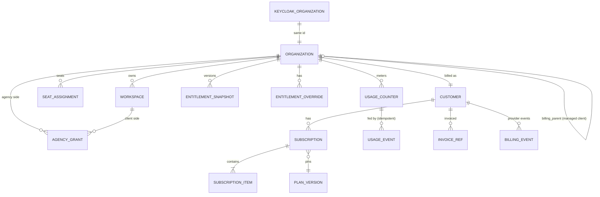
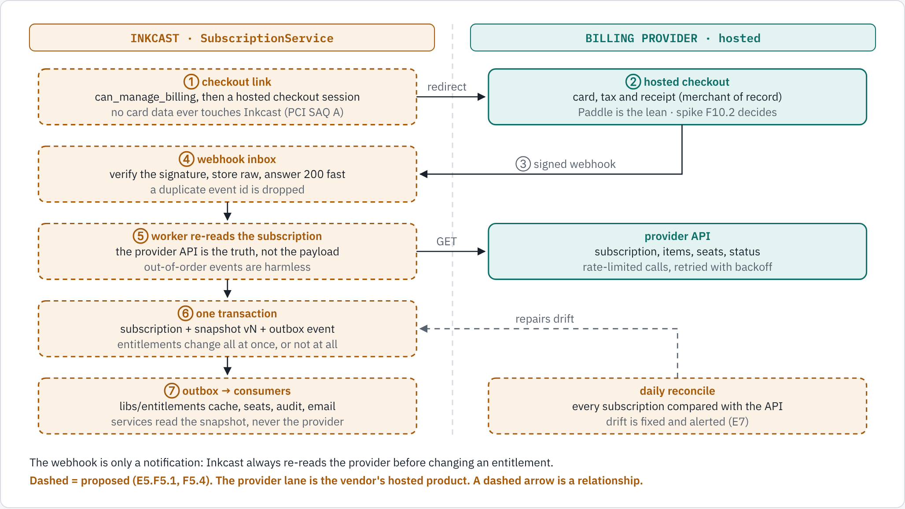
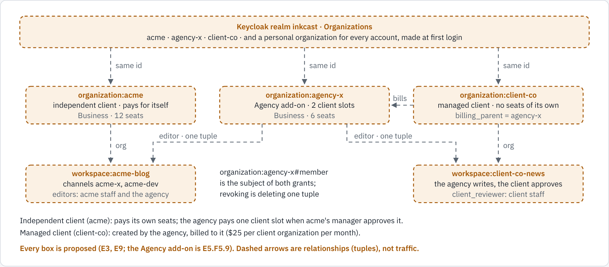
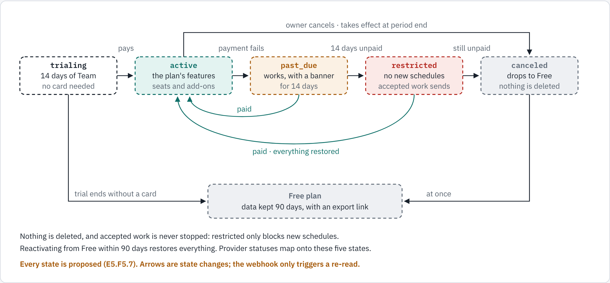

# E10 Tiers, subscriptions and entitlements: design (spike input)

> **Status:** design for the E10 spike, 2026-10-18. Prices are **hypotheses**; F10.1.S2 validates them. Delivery refines **E5** ([backlog](../../backlog/E5-billing.yaml)); authorization is **E3** on OpenFGA ([docs/authorization.md](../../authorization.md)).
> **Decisions:** [ADR-0010](../../adr/0010-pricing-and-packaging.md) pricing and the billing account · [ADR-0011](../../adr/0011-entitlements-and-quotas.md) entitlements and quotas · [ADR-0012](../../adr/0012-offline-licences.md) offline licences · [ADR-0013](../../adr/0013-billing-webhooks-and-events.md) webhooks and card data · the provider ADR comes from F10.2.S4.

## 0. Decisions at a glance

1. **The billing account is the Organization**, keyed by its Keycloak Organization id. Each organization has one subscription. Every account gets a personal organization at first login (E9.F9.2.S2).
2. **Seats are billable for writing, publishing and managing.** Viewers, reviewers, billing admins and client reviewers are free.
3. **Channels are a generous pooled allowance.** Channel packs, and a **credits wallet** for AI assists and paid-platform sends such as X, are sold as add-ons.
4. **Never paywalled:**
   - REST API, MCP and Git sync;
   - the publish ledger, dry run and duplicate protection;
   - data export and account deletion;
   - token revocation;
   - MFA on your own account.
5. **Agency** is an add-on for Business and Enterprise, priced per client organization. It uses the one-tuple grant, a `client_reviewer` relation and white-label, and maps to PolyForm client-publishing rights. It is designed now and built later.
6. **Entitlements** come from `plans.yaml` (code) and are materialised into per-organization snapshots. They are **never** put in JWTs, OpenFGA tuples or the provider's entitlement feature.
7. **At every use case:** OpenFGA allows it (else **403**, or **503** if the check errors), **and** business state allows it (else **409**), **and** the plan allows it (else **402**).
8. **A new `SubscriptionService`** is built from the same codebase. Its in-process workers claim work items. Quota counters live in the schema of the service that owns the resource.
9. **Self-host and air-gapped installs** read an **Ed25519-signed JWS licence file** and never phone home.
10. **Provider:** a bake-off between merchants of record (Paddle, Lemon Squeezy), Stripe with Stripe Tax, and self-hosted Lago. The **lean is Paddle**.

## 1. The ask, refined

Design how Inkcast earns money and enforces what each customer bought:
- Five per-seat tiers (Free, Personal, Team, Business, Enterprise) with generous channel allowances, plus channel packs and credit packs.
- An Agency add-on for Business and Enterprise (client organizations, client reviewers, white-label), mapped to the commercial licence.
- An entitlement catalogue as code, per-organization snapshots, quotas, and offline signed licences.
- A pluggable `BillingProvider`, with the launch provider chosen by a spike.
- Entitlements combined with OpenFGA checks at every use case, for web, mobile, REST and MCP alike.

Deny by default, keep self-host working air-gapped, and merge the delivery into the existing epics.

## 2. Tier strategy

### 2.1 Market scan (verified 2026-10-18)

| Product | Unit | Prices (USD/month) | Gated at higher tiers | Source |
|---|---|---|---|---|
| Buffer | per channel | Free: 3 channels, 1 user. Essentials $6 per channel ($5 annual). Team $12 per channel ($10 annual) | Team: unlimited users, approvals, access levels; API key and request limits rise per tier | [buffer.com/pricing](https://buffer.com/pricing) |
| Hootsuite | per user | Standard from $99 (10 accounts), Professional $199, Advanced up to $399, Enterprise custom | Approvals at Advanced; SSO and compliance at Enterprise | [hootsuite.com/plans](https://www.hootsuite.com/plans) |
| Sprout Social | per seat | Essentials $79 annual / $99 monthly, Standard $199, Professional $299, Advanced $399 | API at Advanced; SSO at Enterprise; AI credits per seat | [sproutsocial.com/pricing](https://sproutsocial.com/pricing/) |
| Publer | accounts + members | Free (3 accounts, 1 user). Professional from $5. Business from $10. Enterprise custom | **Business: API and MCP access**, approvals, AI | [Publer help](https://publer.com/help/en/article/what-are-publers-plans-and-pricing-15h4yqh) |
| Typefully | per social set | Free 15 posts/month. Pro ~$8–10. Business ~$18–20 (third-party figures, June 2026) | — | [socialk.it](https://socialk.it/en/alternatives/typefully) |
| Ghost(Pro) | per site, by staff | Starter $18 (1 staff), Publisher $29 (3), Business $199 (15) | Admin API from Publisher; SSO and SLA on Custom | [ghost.org/pricing](https://ghost.org/pricing/) |
| GitHub | per user | Free, Team $4, Enterprise $21 | SAML, SCIM, audit-log API at Enterprise | [github.com/pricing](https://github.com/pricing) |
| Vercel | per seat + usage | Pro $20 per seat, **free viewer seats** | SAML as an add-on on Pro; SCIM at Enterprise | [vercel.com/pricing](https://vercel.com/pricing) |

**Takeaways:**
- Approvals are always a team-tier feature, and SSO/SCIM are always Business or Enterprise.
- Competitors now gate API and MCP access behind paid tiers (Publer), so **"API, MCP and Git on every tier, Free included"** is a real differentiator.
- Annual discounts run about 17–20%.
- Free viewer seats set the expectation that reviewers aren't charged.

### 2.2 Tiers and starting prices (hypotheses)

| Tier | For | Monthly | Annual | Headline |
|---|---|---|---|---|
| **Free** | Trying it out | $0 | — | 1 user, 3 channels, 20 stories a month, API, MCP and Git |
| **Personal** | One writer | $10 | $100 | 10 channels, unlimited stories (fair use), 10 repos, credits |
| **Team** | Small team with approvals | $18 per seat, 2–20 seats | $180 per seat | Roles, one-step approvals, workspace deploy tokens |
| **Business** | Large team with SSO and audit | $35 per seat, no minimum | $350 per seat | SSO via Keycloak Organizations, 365-day audit with export, multi-step approvals, bring-your-own platform apps, **Agency add-on available** |
| **Enterprise** | Custom | Contract (guide: from $45 per seat, 25-seat minimum) | Annual | Self-host licence, SLA, SCIM, custom roles, SIEM streaming, data residency |

**Add-ons:**

| Add-on | Price | Available on |
|---|---|---|
| Channel pack (+10) | $10/month | Personal and up |
| Credit pack (1,000 credits) | $10 one-time, valid 12 months | Personal and up |
| **Agency** | $25 per client organization per month | Business and Enterprise |

Each Agency client organization adds 15 channels, unlimited client reviewers, white-label and client-publishing rights for that brand.

### 2.3 Entitlement matrix

The keys are the ones used in `plans.yaml`. "–" means not included.

| Key (type) | Free | Personal | Team | Business | Enterprise | Self-host Community | Self-host licensed |
|---|---|---|---|---|---|---|---|
| `seats` (limit) | 1 | 1 | 2–20 | 1–500 | contract | unlimited | per licence |
| Free seats (viewer, reviewer, billing admin) | – | – | unlimited | unlimited | unlimited | unlimited | unlimited |
| `workspaces` | 1 | 3 | 10 | 50 | unlimited | unlimited | unlimited |
| `channels` (pooled) | 3 | 10 | 10 per seat, minimum 20 | 15 per seat, minimum 30 | 25 per seat | unlimited | unlimited |
| `stories_per_month` (meter: one markdown file published or scheduled, any number of platforms) | 20 | unlimited (fair use 1,000) | unlimited (fair use 1,000 per seat) | same | same | unlimited | unlimited |
| `queue` (scheduled at once) | 10 | unlimited | unlimited | unlimited | unlimited | unlimited | unlimited |
| `git_repos` | 1 | 10 | 50 | 200 | unlimited | unlimited | unlimited |
| `pats_per_user` | 2 | 10 | 25 | 50 | 100 | unlimited | unlimited |
| `workspace_tokens` (CI tokens owned by the workspace) | – | – | yes | yes | yes | yes | yes |
| `api_rate` (per minute / per day) | 60 / 1k | 120 / 10k | 300 / 50k | 600 / 200k | contract | config | config |
| `mcp` | yes | yes | yes | yes | yes | yes | yes |
| `mcp_client_allowlist` | – | – | – | yes | yes | yes | yes |
| `approvals` | – | – | one step | multi-step, per-channel policies | custom policies | yes | yes |
| Roles (OpenFGA relations) | owner | owner | full built-in set | + group grants, just-in-time from SSO | + `custom_roles` | all | all |
| `audit_retention_days` | – | 7 | 30 | 365, export and API | 1–7 years, SIEM | your DB | your DB |
| `credits` (monthly wallet) | 0 | 100 | 200 per seat, pooled | 300 per seat, pooled | contract | n/a (bring your own) | n/a |
| `byo_platform_apps` | – | – | – | yes | yes | required | required |
| `mfa_enforce` (whole organization) | own account | own account | yes | yes | yes | yes | yes |
| `sso` (SAML/OIDC via Keycloak Organizations) | – | – | – | self-serve | assisted | your IdP | your IdP |
| `scim` | – | – | – | – | roadmap | Keycloak SCIM | yes |
| `agency` (add-on) | – | – | – | add-on | add-on or contract | – | Agency licence |
| `support` | community | email, 2 business days | email, 1 business day | priority + onboarding | SLA + named contact | community | per licence |

**Meters:**

| Meter | Period | Reserved when | Released when |
|---|---|---|---|
| `stories_per_month` | calendar month (UTC) | publish or schedule | cancelled before sending, or permanent failure |
| `credits` | billing period, then packs (oldest first) | before an AI call or a paid-platform send (hypothesis: X text post = 2, X post with a link = 25) | the platform rejects it before sending |
| `api_requests` | day (approximate) | each request | — |

### 2.4 Never paywalled

The following stay on for every tier, and in every fallback:
- dry run and preview;
- the publish ledger and duplicate protection;
- `unconfirmed` handling;
- REST API, MCP and Git sync (only their volumes are limited);
- export and account deletion;
- token revocation;
- MFA on your own account;
- security notifications.

A catalogue test fails if any of these appears as gated.

### 2.5 Agencies: an add-on for Business and Enterprise

Agencies need Business features anyway (audit of who published what for which client, SSO, multi-step approvals, bring-your-own platform apps per client), and their value metric is the number of clients. An add-on with its own quantity captures that and keeps the pricing page to five tiers. A freelancer pays $35 + $25 for one client: a legal path to client publishing that costs less than ignoring the licence.

| Case | Who owns the client organization | Who pays | Grant |
|---|---|---|---|
| Managed client organization | Created by the agency through the Inkcast API (`billing_parent = agency`) | The agency's subscription | `organization:agency#member editor workspace:<client-ws>` |
| Independent client organization | The client, with its own subscription | The client pays its own seats; the agency pays one client slot | The same tuple, written when a client manager approves the agency |

- **Client slot:** one client organization (one brand) in which the agency holds at least one grant. This is the per-brand metric in `legal/COMMERCIAL-LICENSE.md`.
- **Client reviewer:** a free, workspace-scoped relation, deliberately left out of `viewer`. Client reviewers see and decide only posts in the client-review stage; the stage is DB state.
- **White-label:** logo, colours, sender name, and a custom review domain for the client-review portal, emails and reports. If the add-on lapses, the configuration is kept but frozen.

### 2.6 Trials, grandfathering, downgrades, payment failure

**Trials.**
- Sign-ups "for my team" get a 14-day **reverse trial of Team**: no card, and it ends on Free.
- Business trials (30 days) and Enterprise pilots are on request.
- Trials get no Agency add-on, as a fraud guard.

**Grandfathering.**
- Plan versions are immutable, and a subscription pins its `plan_version`.
- Price rises reach existing customers only at renewal, with 60 days' notice.
- Features are never removed from a published version.

**Downgrades** never delete anything, never double-post, and never silently switch a control off.

| Over the new limit | What happens |
|---|---|
| Channels | The owner picks which channels stay active; the rest are **paused**. Already-scheduled posts are honoured until the period ends, then **held** (never failed, never sent) with 72 hours' notice. |
| Seats | The owner picks who keeps billable relations. Everyone else becomes `viewer` through the E3 grant API, audited. PATs narrow automatically. |
| Workspaces | The extras are archived, read-only and exportable. |
| Approvals | The policy stays enforced until a manager turns it off. |
| SSO | The configuration is kept and becomes read-only. Only an owner can disable it, after re-authenticating. |
| Audit retention | Kept for 30 more days with an export offered, then trimmed. |
| Agency removed | Grants stay, but use cases deny new writes in client workspaces. Already-scheduled client posts are honoured until the period ends. |

**Payment failure.**
1. `past_due`: everything works, with a banner, for 14 days.
2. `restricted`: nothing new can be scheduled; accepted work still goes out.
3. `canceled`: the organization drops to Free.

Data is kept for 90 days with an export link, and reactivating restores everything.

### 2.7 PolyForm Shield, tiers and editions

| Use | Cloud | Self-host |
|---|---|---|
| Your own content, any scale | Free to Enterprise | **Community, free**, all features (open question 1) |
| Client publishing (agencies, freelancers) | Business or Enterprise + **Agency add-on** | **Agency licence** (`client_orgs: N`) |
| Monetising Inkcast; OEM; hosting for others | Enterprise contract | Service-provider or OEM licence |
| Assurances (support, SLA, LTS) | Enterprise | Enterprise licence (signed images, SBOMs, air-gap bundle) |

### 2.8 Differentiators

1. **Git-native publishing:** the ledger updates posts in place and never duplicates them, PRs get previews, and PR review can serve as approval. Proposed: trusted publishing through GitHub Actions OIDC, with no PAT stored.
2. **MCP-native, safely:** consent on every client, and tokens never reach an AI transcript. Bring your own assistant: writing through Claude Code needs no AI credits.
3. **API, MCP and Git on every tier.**
4. **Duplicate-safe:** no blind retries, and `unconfirmed` posts are confirmed with the platform.
5. **Security posture:** scoped, hashed PATs that never exceed your role; MFA enforcement from Team; startup posture checks; authorization that fails closed.
6. **Air-gapped self-host with an offline licence.**
7. **Fair seats:** reviewers, viewers and billing admins are free.
8. **Source-available:** your own content is free; agencies pay.
9. **Cost transparency:** a dry run shows a post's credit cost.

## 3. Domain model

| Entity | Owner (single writer) | Notes |
|---|---|---|
| User | IdentityService (E9) | Keyed `oidc:<issuer>#<sub>`; one per Keycloak user |
| Organization (business row) | E3 org/workspace API | **id = Keycloak Organization id**; `kind` (personal, team, client); `billing_parent_org_id`; settings |
| Workspace | E3 | `org_id`, `kind` (internal or client) |
| Relations (roles) | OpenFGA, written by the E3 API; org membership synced by E9.F9.5 | Never business state |
| SeatAssignment | E3 grant API, in the same transaction as the grant | `(org_id, user_id, source_relation)`; emits `seat.*` events |
| AgencyGrant | E3 grant API | `(agency_org, client_org, workspace_id)`; counts client slots |
| Customer, Subscription, SubscriptionItem | SubscriptionService | Provider ids, `plan_key`, `plan_version`, status, period, quantities |
| Plan, Price, AddOn, Meter, Feature | `plans.yaml` (code) | Versioned; provider price ids per environment in `deploy/billing/price-ids.<env>.yaml` |
| EntitlementOverride | SubscriptionService (operator API, E6.F6.4.S2) | Reason, ticket and an **expiry** are required |
| EntitlementSnapshot | SubscriptionService | Per organization, with a monotonic `version` |
| UsageCounter, UsageEvent | The owning service's schema | The event id is the idempotency key |
| InvoiceRef, BillingEvent (inbox), LicenceRegister | SubscriptionService | No PDFs stored; **the licence signing key is never in the SaaS** |



## 4. Authorization meets entitlements

**Roles map to relations** in the [authorization design](../../authorization.md) §4. Billable relations: org owner and admin, workspace manager and editor, channel publisher. Free relations: `billing_admin`, `reviewer`, `viewer`, `client_reviewer`.

**Seats are derived from relations.** The E3 grant API is the only writer of billable relations. In one transaction it checks `seats` on the snapshot, upserts `seat_assignments`, and appends an outbox row that writes the tuple and emits `seat.assigned`. SubscriptionService then syncs the quantity: increases are prorated now, decreases apply at renewal, debounced. A reconcile job compares the ledger with OpenFGA.

| Action | OpenFGA relation | Plan gate | Session only (no PAT) |
|---|---|---|---|
| Change plan, buy packs or add-ons, billing portal | `can_manage_billing` | — | yes |
| See plan, invoices, usage | `can_view_billing` / `workspace#can_view_usage` | — | no |
| Invite members; grant billable relations | `can_manage_members` | `seats` | yes |
| Grant `reviewer` | `workspace#can_manage_members` | `approvals` (Team+) | yes |
| Grant `client_reviewer`; write an agency grant | `can_manage_members` (client org) | `agency` + `client_orgs` on the **agency's** snapshot | yes |
| Create a workspace | `can_create_workspace` | `workspaces` | no |
| Connect a channel | `can_manage_channels` | `channels` | no |
| Create or edit a post | `can_create_post` / `can_edit` | `queue`, `stories_per_month` | no |
| Approve | `can_approve` | `approvals` | yes (MCP returns a link) |
| Publish or schedule | `can_publish` | `stories_per_month`, `credits`; the channel is active and approval is satisfied (DB) | no |
| Create a PAT | `can_create_token` | `pats_per_user` | yes |
| Configure SSO or the MCP client allow-list | `can_manage_security` | `sso`, `mcp_client_allowlist` | yes |
| Read or export the audit log | `can_view_audit` | `audit_retention_days`; export at Business+ | export: yes |
| Manage custom roles | `can_manage_custom_roles` | `custom_roles` | yes |

**Composition at a use case** (shared layer, one path for web, mobile, REST and MCP):

```python
async def schedule(actor: Principal, req) -> PostInfo:
    await authz.require(actor, "can_publish", Ref("channel", req.channel_id), scope="posts:write")  # 403 / 503
    post, ch = posts.get(req.post_id), channels.get(req.channel_id)                                  # business state
    if policies.requires_approval(post.workspace_id) and post.status != "approved":
        raise ApiError(409, "approval_required", "Submit this post for approval first.")
    if ch.status != "active":
        raise ApiError(409, "channel_paused", "This channel is paused on your current plan.")
    org = workspaces.billing_org(post.workspace_id)              # a managed client org resolves to its agency
    if via_agency := agency_grants.for_actor(actor, post.workspace_id):
        entitlements.for_org(via_agency.agency_org).require(Feature.AGENCY)             # 402 if the add-on lapsed
    ent = entitlements.for_org(org)
    with store.tx() as tx:                                       # reservation and write in one transaction
        quota.reserve(tx, org, Meter.STORIES_PER_MONTH, 1, key=f"story:{post.group_id}:{req.month}",
                      limit=ent.limit(Meter.STORIES_PER_MONTH))
        if ch.platform_costs_credits:
            quota.reserve(tx, org, Meter.CREDITS, ch.credit_cost(post), key=f"send:{post.id}:{ch.id}",
                          limit=ent.limit(Meter.CREDITS))
        posts.schedule(tx, post, ch); audit(tx, actor, "post.scheduled"); outbox(tx, "post.scheduled")
```

The **402 body** is RFC 9457 problem+json with `limit`, `allowed`, `used` and `upgrade_url`, plus either `can_upgrade` (worked out from `can_manage_billing`) or `ask` ("an owner or billing admin of Acme"). MCP tools and the CLI render the same object as one line of text.

**PATs:** effective power = the token's scopes ∩ the creator's current relations ∩ the organization's plan. Entitlements are always resolved from the organization, never from token claims.

## 5. Architecture

### 5.1 `SubscriptionService` (`subscription-service`)

It is a new `ServiceSpec` from the same codebase. It owns:
- the plan catalogue API, subscriptions, and checkout and portal sessions;
- provider webhooks (inbox);
- snapshots and operator overrides;
- invoices;
- seat sync, dunning and trial timers, reconciliation;
- the licence register.

Workers run in-process (`ServiceSpec.workers`) and claim work with `FOR UPDATE SKIP LOCKED`, so replicas are safe. There's no separate metering worker: counters live where the resource lives.

**Route table entries** (longest prefix wins over PublishingApi's `/api`): `/api/v1/plans`, `/api/v1/billing`, `/webhooks/billing/`.

| Operation | Path | Check |
|---|---|---|
| List plans (public, ETag, rate-limited) | `GET /api/v1/plans` | none |
| Entitlements | `GET /api/v1/billing/orgs/{org}/entitlements` | `organization#member` |
| Subscription, invoices | `GET …/subscription`, `GET …/invoices` | `can_view_billing` |
| Usage | `GET …/usage` | `can_view_billing` or `workspace#can_view_usage` |
| Checkout and portal sessions | `POST …/checkout-sessions`, `POST …/portal-session` | `can_manage_billing`, session only |
| Preview and change the plan | `POST …/subscription:preview`, `POST …/subscription:change` | `can_manage_billing`, session only |
| Operator overrides | `POST /api/v1/billing/admin/orgs/{org}/overrides` | `inkcast-admin` with MFA; audited |
| Provider webhooks | `POST /webhooks/billing/{provider}` | signature |

**Events** (outbox):
- **Emits:** `subscription.changed`, `entitlements.changed {org, version}`, `payment.failed`, `payment.recovered`, `trial.ending`, `downgrade.scheduled`, `usage.threshold`.
- **Consumes:** `org.created`, which creates the Free subscription; `org.deleted`; `seat.*`; and `agency_grant.*`.

### 5.2 `libs/entitlements`

```python
ent = ctx.entitlements.for_org(org_id)    # immutable snapshot: 60 s cache, last-known-good up to 24 h
ent.require(Feature.APPROVALS)            # 402 PlanRequired
ent.check_count(Limit.CHANNELS, current)  # 402 PlanLimit, inside the owner's transaction
quota.reserve(tx, org_id, Meter.CREDITS, n, key=..., limit=ent.limit(Meter.CREDITS))   # atomic and idempotent
```

The source is set by `INKCAST_ENTITLEMENTS_SOURCE`:
- `store`: the SaaS;
- `licence`: a signed file, for self-host;
- `community`: the self-host default;
- `static`: tests.

**Fail-safe classes.** Authorization always fails closed; these apply to plan data only.

| Class | Examples | No snapshot and no last-known-good | Stale (under 24 h) |
|---|---|---|---|
| Safety controls (DB settings, not entitlements) | SSO enforcement, required MFA, approval policy, audit writing | always enforced | — |
| Accepted work | posts already reserved and scheduled | honoured | honoured |
| Cost-bearing | credits | denied (402) | last-known-good |
| Capacity | seats, channels, workspaces, repos, PATs, stories | **Free-plan limits** | last-known-good |
| Premium | approval depth, agency, white-label | Free defaults; configuration kept | last-known-good |
| Always on | API, MCP, Git, dry run, ledger, export | on | on |

**Atomic quota** (works on SQLite 3.24+ and Postgres):

```sql
INSERT INTO usage_counters (org_id, meter, period, used) VALUES (:o, :m, :p, :n)
ON CONFLICT (org_id, meter, period) DO UPDATE SET used = used + excluded.used
WHERE usage_counters.used + excluded.used <= :limit
```

If no row changed, the reservation is denied. A `usage_events` row with a deterministic id is written in the same transaction, so a retry counts once. A cancel writes a compensating event. There is no post-paid metered billing at launch; the `MeterSink` seam (Lago, OpenMeter) is there for later.

### 5.3 Offline licences

The licence is a compact JWS, `alg: EdDSA` (Ed25519), verified with `cryptography`, which is already a dependency:

```json
{"iss": "https://licensing.inkcast.dev", "aud": "inkcast-selfhost", "sub": "cus_acme", "jti": "lic_01",
 "iat": 1767225600, "nbf": 1767225600, "exp": 1798761600, "grace_days": 30,
 "edition": "enterprise", "deployment": {"public_url_host": "inkcast.corp.example"},
 "entitlements": {"features": {"custom_roles": true}, "limits": {"seats": 500, "client_orgs": 0}}}
```

- **Mounting:** as a file (`INKCAST_LICENCE_FILE`), hot-reloaded.
- **Keys:** public keys ship in the image by `kid`, with a revoked-kid list.
- **Expiry:** a warning 30 days ahead, then the grace period, then licensed features go read-only. **Publishing your own content never stops.**
- **Signing:** an offline `inkcast licence sign` on a hardware-backed key.

### 5.4 Seams

| Seam | Adapters | Default |
|---|---|---|
| `BillingProvider` (`libs/billing`) | fake, Paddle, Lemon Squeezy, Stripe (+ Stripe Tax), Lago, manual | fake in dev and CI; the bake-off winner in production |
| `EntitlementSource` | store, licence file, community, static | store (SaaS), community (self-host) |
| `MeterSink` | local, Lago, OpenMeter | local |
| `PolicyEngine` (E3) | OpenFGA, local evaluator | OpenFGA |
| `EventBus` | outbox polling, a broker later | outbox polling |

**`BillingProvider` methods:**
- `checkout_session(org, items, success_url, cancel_url, idempotency_key)`
- `portal_session(customer)`
- `verify_webhook(headers, raw_body)`
- `parse_event(raw)`
- `get_subscription(id)`
- `update_quantity(sub, item, qty, proration)`
- `change_plan(...)`
- `cancel(at_period_end)`
- `list_events_since(cursor)`

Provider SDK types never leave the adapter.

### 5.5 Provider bake-off (F10.2)

| Option | Merchant of record | Fees | Fit for a solo US founder selling globally | Source |
|---|---|---|---|---|
| **Paddle Billing** | yes | 5% + 50¢ | Paddle files and remits sales tax and VAT worldwide; mature seat and proration support | [paddle.com/pricing](https://www.paddle.com/pricing) |
| Lemon Squeezy | yes | 5% + 50¢ | Stripe-owned since 2024 while Stripe builds Managed Payments; risky for a new build | [fintechfutures](https://www.fintechfutures.com/fintech-start-ups/stripe-buys-us-paytech-start-up-lemon-squeezy) |
| Stripe Billing + Stripe Tax | **no** | ~2.9% + 30¢, +0.7% Billing, +0.5% Tax | Cheapest per transaction, but **you register, file and remit** | [stripe.com/pricing](https://stripe.com/pricing) |
| Lago, self-hosted | no | AGPLv3 | A billing and metering engine that still needs a processor and tax handling, plus ops | [getlago/lago](https://github.com/getlago/lago) |
| *Note:* Stripe Managed Payments | yes | +3.5% | Checkout and Payment Links only, with constraints | [docs](https://docs.stripe.com/payments/managed-payments/how-it-works) |

**Scoring criteria:**

| Criterion | Weight |
|---|---|
| Tax and compliance burden | 30% |
| Fees | 20% |
| Seats, proration and trials | 15% |
| B2B invoicing | 10% |
| Webhook quality and re-fetch API | 10% |
| Lock-in and exit path | 10% |
| CI testability | 5% |

**Lean: Paddle.** Being the merchant of record removes worldwide tax filing for a solo founder. Move to Stripe + Stripe Tax when revenue justifies a tax function. **Stripe Entitlements are not used** under any option: self-host needs local entitlements anyway ([docs](https://docs.stripe.com/billing/entitlements)).

### 5.6 Webhooks and card data

See [ADR-0013](../../adr/0013-billing-webhooks-and-events.md).
- **Checkout and portal are hosted**, so Inkcast never touches card data (PCI SAQ A).
- **Signature:** a raw-body HMAC (for Paddle, `Paddle-Signature: ts=…;h1=…` over `ts:body`) with a timestamp tolerance, a 64 KB cap and the secret read via `_FILE`.
- **Processing:** an inbox that is unique on the provider's event id, a fast 200, then a **re-fetch from the provider's API**, which is the source of truth.
- **Outbox and reconciliation:** transactional outbox events, and a daily reconciliation that alerts on drift.

### 5.7 The catalogue as code

```yaml
# src/inkcast/libs/entitlements/catalogue/plans.yaml (in the image; no provider ids)
catalogue: 2026-11
features:
  approvals:         {type: enum,  class: premium, values: [none, one_step, multi_step]}
  sso:               {type: bool,  class: premium}
  agency:            {type: bool,  class: premium}
  seats:             {type: limit, class: capacity}
  channels:          {type: limit, class: capacity}
  stories_per_month: {type: meter, class: capacity, period: calendar_month}
  credits:           {type: meter, class: cost, period: billing_period}
plans:
  team:
    versions:
    - version: 1
      status: public            # public | legacy | private
      entitlements: {seats: {min: 2, max: 20}, channels: {per_seat: 10, min: 20}, approvals: one_step,
                     credits: {per_seat: 200}, audit_retention_days: 30}
      prices:
      - {key: team.v1.seat.month, unit: seat, interval: month, amount: {USD: 1800}}
      - {key: team.v1.seat.year,  unit: seat, interval: year,  amount: {USD: 18000}}
addons:
  channels_10:   {applies_to: [personal, team, business, enterprise], grants: {channels: 10}}
  credits_1000:  {kind: pack, grants: {credits: 1000}, expires_days: 365}
  agency_client: {applies_to: [business, enterprise], unit: client_org, grants: {agency: true, client_orgs: 1, channels: 15}}
```

**Feature flags vs entitlements.**
- Flags are short-lived engineering switches; entitlements are commercial rights. **Never gate a paid feature with a flag.**
- Order of evaluation: flag → authorization → state → entitlement.

**Configuration:**
- `INKCAST_BILLING_PROVIDER`
- `INKCAST_BILLING_API_KEY_FILE`
- `INKCAST_BILLING_WEBHOOK_SECRET_FILE`
- `INKCAST_PRICE_IDS_FILE`
- `INKCAST_ENTITLEMENTS_SOURCE`
- `INKCAST_LICENCE_FILE`

**Posture checks:**
- A fake provider in production fails.
- A missing webhook secret fails.
- An invalid licence fails.
- A licence expiring within 30 days warns.

### 5.8 Diagrams

The diagrams are drawn to the diagram-kit `/visual` standard, **light theme only**: solid boxes are what exists, dashed boxes are proposed. Their sources are in [`docs/diagrams/`](../../diagrams/).


*Every client and job goes through the same four gates.*



*The webhook is only a notification; the provider's API is the truth.*



*An agency gets into a client workspace with one relationship.*



*Payment failure never deletes data and never stops accepted work.*

## 6. Delivery

The full lists are in the backlog: [E10 spike](../../backlog/E10-tiers-and-billing.yaml) and refined [E5](../../backlog/E5-billing.yaml). Each E5 story is marked `refined`, `new` or `replaces`, with acceptance criteria.

**Asks to other epics:**
- E3: organization and workspace kinds, `billing_parent`, and a grant API that writes `seat_assignments` and `agency_grants` (F3.2.S6).
- E9: `org.created` (F9.2.S2), and membership feeding seats (F9.5).
- E4: seat badges and paywalls in F4.8 and F4.9.
- E6: overrides through the operator API (F6.4.S2), plus a licence-register view (F6.4.S4).
- E7: billing and licence alerts (F7.1.S2).
- E8 / issue 21: X costs feed the credits wallet.

**Order:**
1. The E10 spike, in parallel with E9.
2. E10 decisions **before the E3 schema freeze**.
3. E5 wave A (catalogue, `libs/entitlements`, webhooks, licences) on SQLite, in parallel with E3.
4. E5 wave B (enforcement, real provider, lifecycle) after E3.
5. The UI after the E4 shell. Agency comes later.

## 7. Mockups

Light, self-contained HTML plus PNG, in [`mockups/`](mockups/). Approve these before any UI code.

| Mockup | Story | Content |
|---|---|---|
| [pricing](mockups/pricing.html) | E5.F5.5 | Monthly/annual toggle, five tiers, Agency band, comparison table, the "always free" strip |
| [billing-usage](mockups/billing-usage.html) | E5.F5.5 | Plan card, meters with reset dates and 80% warnings, add-ons, invoices, a read-only view for billing viewers |
| [paywall](mockups/paywall.html) | E5.F5.5.S3 | A limit reached: the owner's "upgrade" and a member's "ask your owner", plus the same 402 as MCP and CLI text |
| [members-seats](../E4-web-app/mockups/members-seats.html) | E4.F4.8 | Members with relations, billable or free badges, MFA/SSO, an invite with seat impact, agency access |
| [approvals](../E4-web-app/mockups/approvals.html) | E4.F4.9 | Queue with per-platform previews, Git origin, policy chip, client step |

The remaining mockups (checkout handoff, downgrade, roles editor, agency switcher, client review, admin override, licence) are spike story F10.5.S1.

## 8. Risks and open questions

| Risk | Mitigation |
|---|---|
| Wrong prices | Validation in F10.1.S2; plan versions make changes cheap |
| Provider onboarding or lock-in | Fake provider first; a contract test suite; an exit plan in the ADR |
| Tax exposure without a merchant of record | Weighted at 30% in the bake-off |
| Seats drift between the ledger, OpenFGA and the provider | A single writer plus reconcile jobs |
| Cross-organization agency grants leak data | Authorization first; agency checks against the agency's snapshot; cross-tenant negative tests |
| Downgrades hurt customers | Nothing is deleted; posts are held, never failed; previews |
| X price changes | Credit weights live in the catalogue, not the code |
| Licence key compromise | Offline signer and `kid` rotation |

### 8.3 Open questions

Each has a recommended default; decided in F10.5.S3.

1. **Self-host Community** gets all features for your own content. *Default: yes; revisit after 12 months.*
2. **A Keycloak Organization for every sign-up** (a personal organization). *Default: yes, if the F10.4.S1 scale probe passes; otherwise create one on the first invite or upgrade.*
3. **Seat rule:** writing, publishing and managing are paid; viewing, reviewing, billing and client review are free. *Default: yes.*
4. **One credits wallet** for AI assists and paid-platform sends. *Default: yes.*
5. **No seat minimum on Business**, so a freelancer can buy Business ×1 plus Agency. *Default: yes.*
6. **A 14-day reverse trial of Team** with no card; Business on request. *Default: yes.*

---
<!-- inkcast-nav -->
[Docs](../../README.md) · [Licensing](../../../LICENSING.md) · [Legal](../../../legal/README.md) · [Contributing](../../../CONTRIBUTING.md) · [Security](../../../SECURITY.md) · [Inkcast README](../../../README.md)
