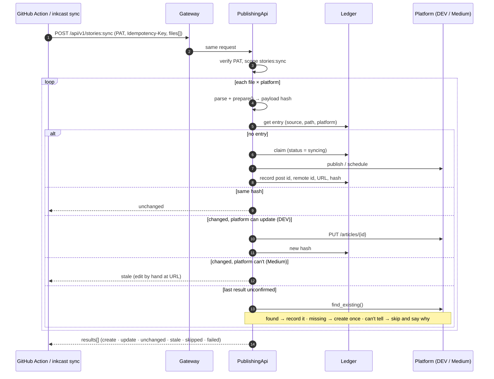
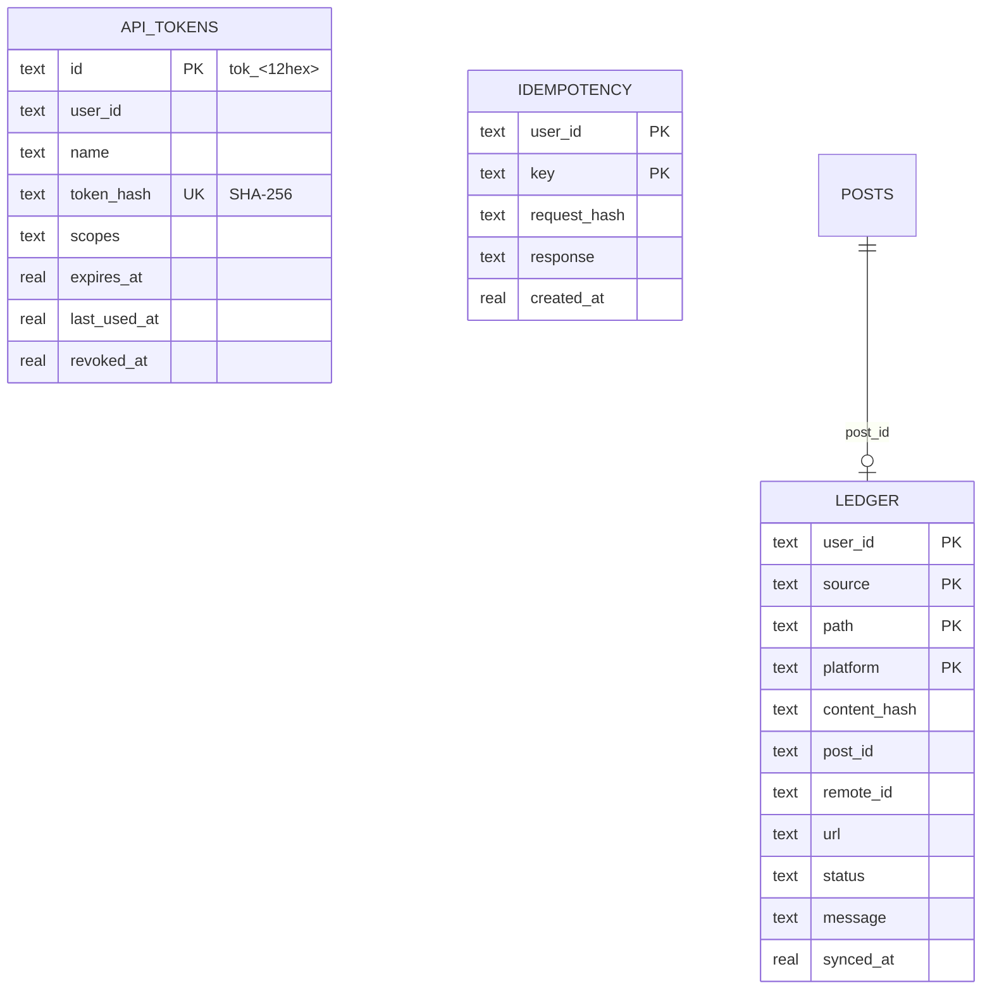

# E2 Git publishing: design

## Goal

A writer keeps stories as markdown in a Git repository. Pushing to `main` publishes new stories and updates changed ones on every platform, **never duplicating a post**. Pull requests show a preview of what would happen. The same works from any CI or a laptop (`inkcast sync`), and from Claude Code (`inkcast_sync`).

## Use cases

| Actor | Story |
|---|---|
| Writer | "I merge `posts/hello.md`; it appears on DEV and Medium with the canonical link to my blog." |
| Writer | "I fix a typo and push; the DEV article is edited in place. Medium can't be edited, and I'm told so, with the link to edit by hand." |
| Writer | "I open a PR; a comment shows the title, tags and status each platform will get." |
| Writer | "A file with `publish_at` in its front matter is scheduled at that time, never sent before it. If I change it before then, the scheduled post is replaced." ([ADR-0015](../../adr/0015-publish-at-is-always-scheduled.md)) |
| CI | "A retried job, or two jobs racing, never posts twice." |
| Security | "The CI credential can only sync stories. It can be revoked at once and can't create more credentials." |

## System design

### Duplicate safety, layer by layer

1. **The ledger** maps `(user, source, path, platform)` to what was sent: a hash of the rendered payload. The schedule time is excluded from the hash, so a past date in old front matter doesn't count as a change.
2. **The claim:** a new entry is written as `syncing` in one transaction *before* anything is sent. A concurrent sync of the same file sees the claim and skips. A crashed claim expires after 10 minutes.
3. **Unconfirmed is never retried blindly:** an ambiguous failure (timeout after sending, 5xx) is checked with `Platform.find_existing` on the next sync.
4. **Idempotency-Key:** a retried request with the same key gets the stored response back (24 h). Reusing a key for a different body is a 422.
5. **The GitHub Action** runs with `concurrency: inkcast-publish` in the example workflow.

### Data

### API

| Method and path | Scope | Notes |
|---|---|---|
| `POST /api/v1/tokens` | OAuth only | returns the token once |
| `GET /api/v1/tokens` | OAuth only | never returns the token |
| `DELETE /api/v1/tokens/{id}` | OAuth only | revokes at once |
| `GET /tokens/new?name&scopes&days` | browser | fresh sign-in → confirm → token shown once |
| `POST /api/v1/stories:sync` | `stories:sync` (dry run: `posts:read`) | the sync |
| `GET /api/v1/ledger?source=` | `posts:read` | what each file became |
| `POST /api/v1/preview` | `posts:read` | exactly what `prepare()` produces |
| MCP `inkcast_sync`, `inkcast_create_token` | `stories:sync` / OAuth | the tool returns a *link*, never a token |

### The platform plug-in contract grows

- `capabilities` holds `"update"` and/or `"find"`.
- `update(creds, account, remote_id, prepared, destination)` edits a post in place.
- `find_existing(creds, account, prepared)` looks a post up to settle an unconfirmed publish.
- **DEV:** `PUT /articles/{id}` and `GET /articles/me/all`.
- **Medium:** neither, so changed files are `stale`.

## Lessons applied

These are from other schedulers' issue trackers:

| Lesson | Applied |
|---|---|
| Infinite repost loops after a post succeeded but a follow-up step failed | Recording the result can't trigger a resend. Uncertain outcomes become `unconfirmed`, then get checked. |
| Silent failures | Every file × platform gets an explicit action and message, written to the job summary and the PR comment. |
| Shared credentials, no per-tenant control | Per-user PATs with minimal scopes, revocable, with last-used time recorded. |

## Risks

- **Medium can't be edited:** writers must fix changes by hand. The `stale` result says exactly where.
- **Ledger entries are per user.** Workspaces (E3) will re-key them by workspace, and the migration copies them across.

---
<!-- inkcast-nav -->
[Docs](../../README.md) · [Licensing](../../../LICENSING.md) · [Legal](../../../legal/README.md) · [Contributing](../../../CONTRIBUTING.md) · [Security](../../../SECURITY.md) · [Inkcast README](../../../README.md)
