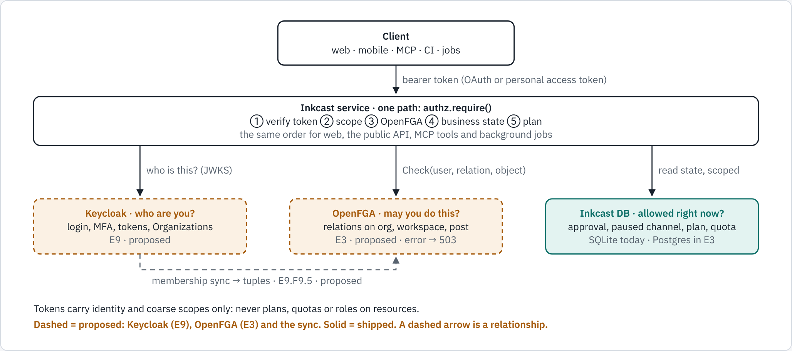
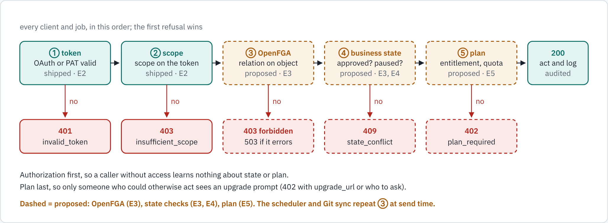

# E3 Tenancy, data and authorization (OpenFGA): design

## Goal

Move Inkcast from one user per account to **organizations and workspaces** on **PostgreSQL**, with authorization on **OpenFGA from day 1**:
- deny by default;
- one enforcement path for web, mobile, REST, MCP and background jobs;
- business state in the DB.

The full authorization design is [docs/authorization.md](../../authorization.md); this page is the epic's view of it.

## What changed in this refinement

E3 originally planned role columns on a members table and a rule that you can only grant roles at or below your own. Both are **replaced**:
- **roles are OpenFGA relations** ([authz/model.fga](../../../authz/model.fga));
- **"who may manage members" is a model rule** (`can_manage_members`).

Isolation keeps database row-level security as defence in depth behind OpenFGA.

| Story | Change |
|---|---|
| F3.2.S1 organizations and workspaces | Refined: business state only; organization id = Keycloak Organization id; a personal organization per account; `kind` and `billing_parent` for agencies |
| F3.2.S2 roles | Replaces the role columns: OpenFGA relations |
| F3.2.S3 managing members | Replaces "at or below your own": `can_manage_members` |
| F3.2.S6 grant API (new) | Writes `seat_assignments` and `agency_grants` with the tuple; checks entitlements first (E5) |
| F3.3 isolation and audit | Refined: RLS behind OpenFGA; cross-tenant tests at model and API level; every grant and revoke audited |
| F3.0, F3.5–F3.9 (new) | Spike, model as code, pluggable engine, one enforcement path, relationship lifecycle, OpenFGA operations |

Full list: [backlog](../../backlog/E3-tenancy-data-and-authorization.yaml).

## System design

*Three systems, three questions. No permission ever travels in a token.*

*Every route, MCP tool and job uses the same `require()`.*

### The model, done in this refinement

`authz/model.fga` and `authz/model.fga.yaml` are committed, and CI runs `fga model test`. Locally the suite reports 14 tests, 39 checks and 3 list-objects checks, all passing.

The owner's model, with two refinements:
- **Removed authors can't edit.** An author keeps edit rights only while they still have workspace access.
- **Publishing needs workspace access.** A direct publisher grant isn't enough on its own.

It also adds the team and tier relations (billing admin, client reviewer, member management, usage and audit visibility) and Enterprise custom roles.

### Data

- **Business tables:** organizations and workspaces (Postgres) hold business state only.
- **OpenFGA store:** a separate Postgres database run by the same operator.
- **Outbox:** tuples are written through a transactional outbox, so the database and OpenFGA can't diverge. A reconciler catches drift.

## Risks

- **Check latency on hot paths.** The F3.0.S1 spike measures it, and batching plus `ListObjects` on workspaces mitigate it.
- **Drift between Keycloak, the database and OpenFGA.** Outbox, reconcilers and alerts (E7.F7.1.S2) cover it.

---
<!-- inkcast-nav -->
[Docs](../../README.md) · [Licensing](../../../LICENSING.md) · [Legal](../../../legal/README.md) · [Contributing](../../../CONTRIBUTING.md) · [Security](../../../SECURITY.md) · [Inkcast README](../../../README.md)
