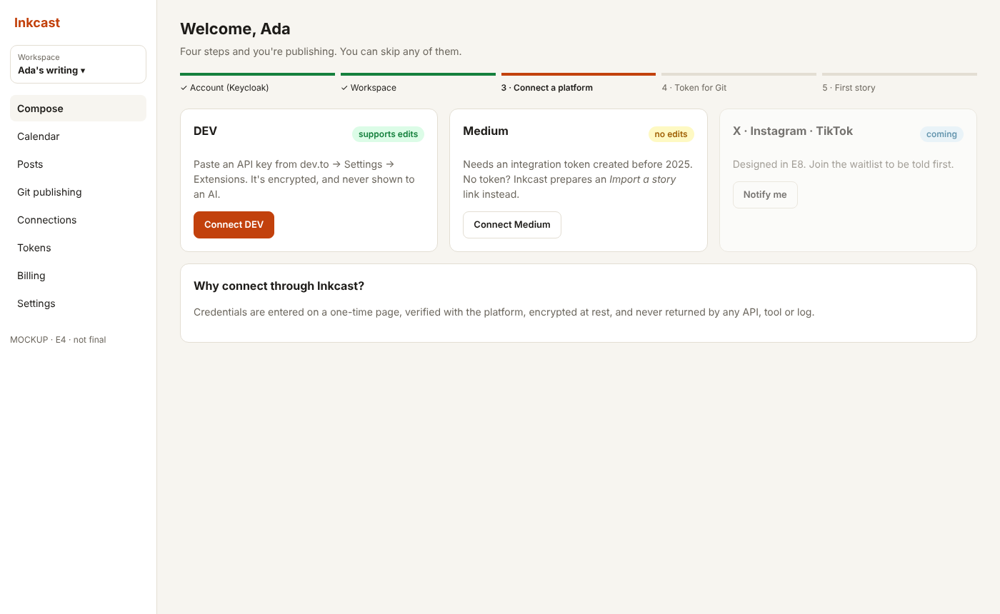
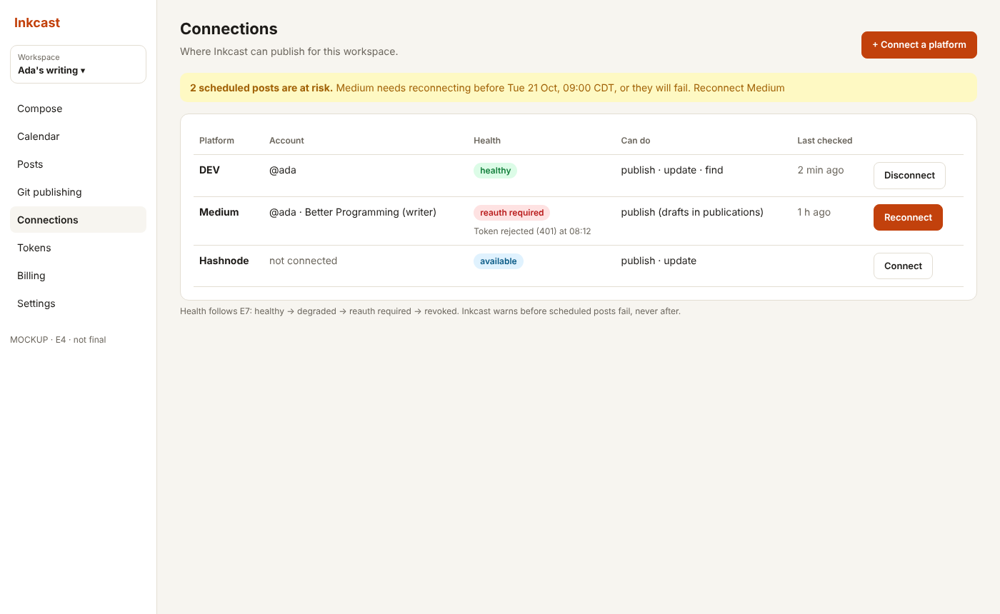
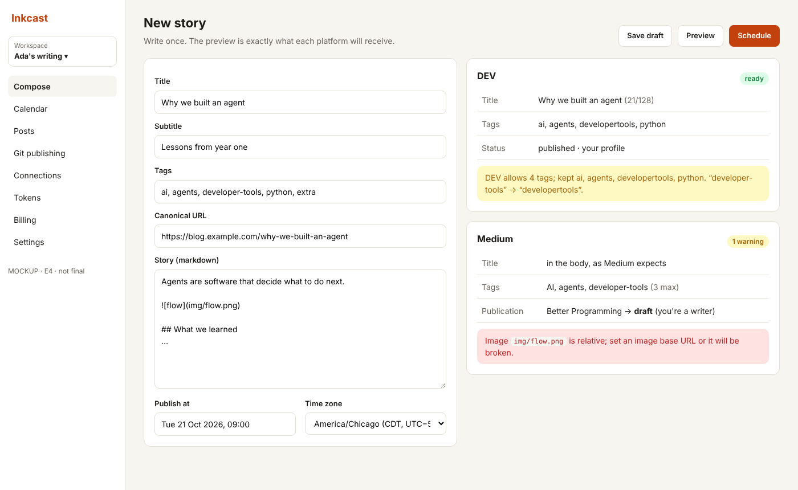
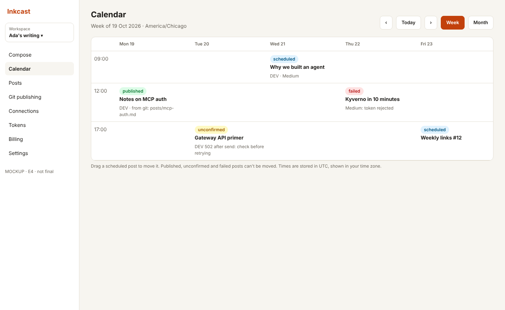
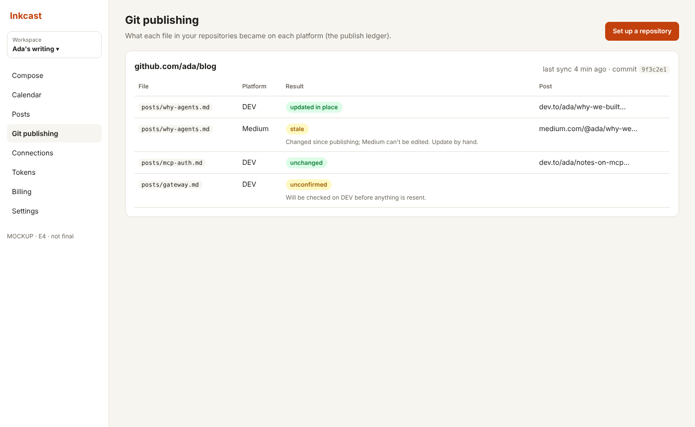
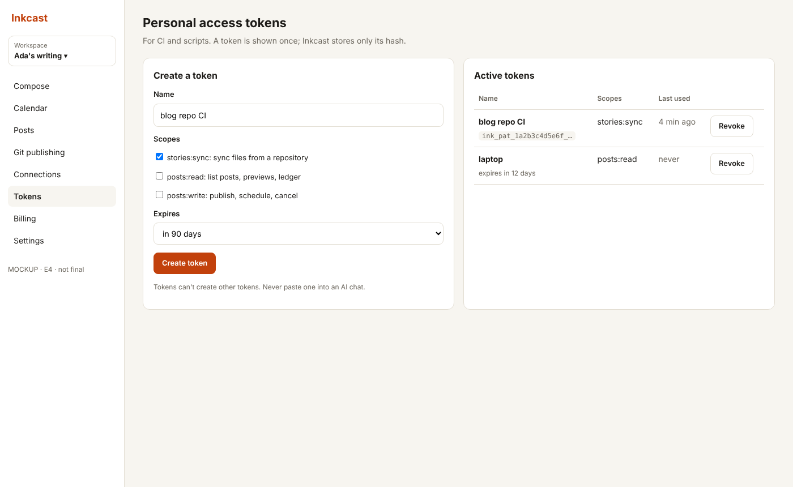
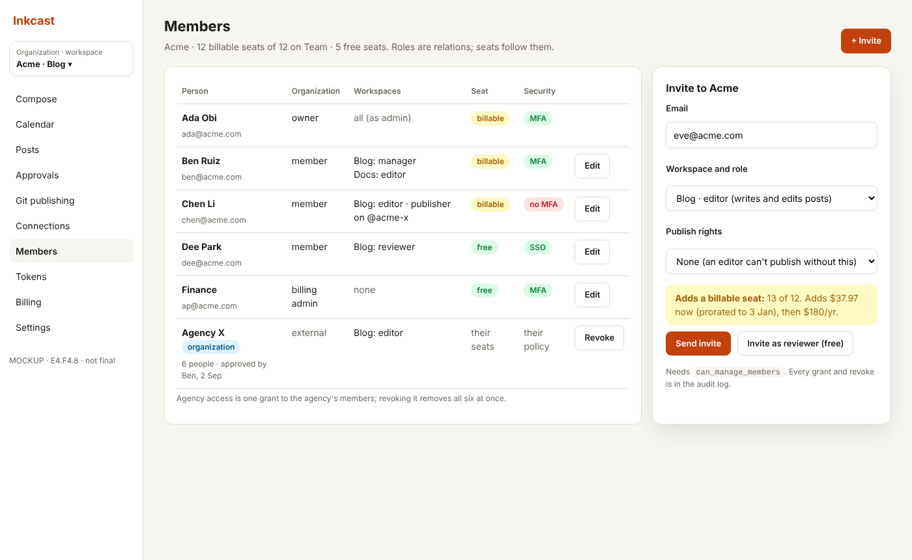
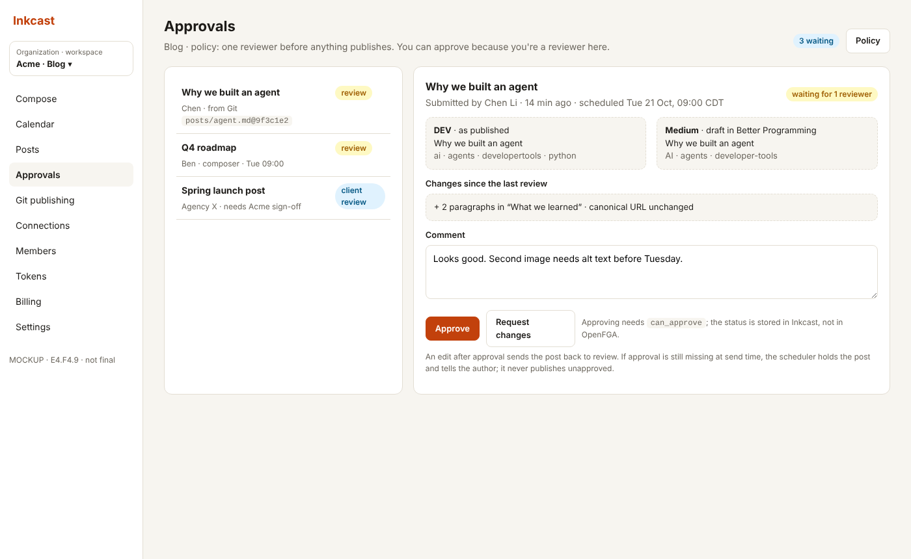

# E4 SaaS web app: design (draft for approval)

**Status:** mockups for review. No UI code is written until these are approved (definition of done, epic #1).

## Use cases

| Screen | The writer can… | Stories |
|---|---|---|
| Onboarding | sign up through Keycloak (Google, GitHub, email), get a workspace, connect a first platform, get a CI token, see the Git guide | F4.3 |
| Connections | see each platform's health and what it can do; reconnect *before* scheduled posts fail | F4.4 (health from E7) |
| Composer | write once and see exactly what each platform will receive, with counters and warnings, then schedule in their own time zone | F4.5 |
| Calendar | see the week or month, drag scheduled posts, and spot failed or unconfirmed posts | F4.6 |
| Git publishing | see what each repository file became on each platform (the ledger), including stale and unconfirmed results | F4.7 / E2 |
| Tokens | create, see and revoke personal access tokens (each shown once) | F4.7 / E2 |

## Mockups

Self-contained HTML (open in a browser) plus PNG. Light theme shown; the design system adds dark mode. All screens work down to 360 px wide (`composer-mobile.png`).

| | |
|---|---|
| [Onboarding](mockups/onboarding.html)  | [Connections](mockups/connections.html)  |
| [Composer](mockups/composer.html)  | [Calendar](mockups/calendar.html)  |
| [Git publishing](mockups/git-publishing.html)  | [Tokens](mockups/tokens.html)  |
| [Members and seats](mockups/members-seats.html) (F4.8)  | [Approvals](mockups/approvals.html) (F4.9)  |

Members and approvals (added 2026-10-18) follow the [authorization design](../../authorization.md): roles are OpenFGA relations, seats follow them ([E10](../E10-tiers-and-billing/design.md)), and approval status lives in the Inkcast database. Billing, usage, pricing and paywall screens are in [E10's mockups](../E10-tiers-and-billing/mockups/).

## System design

- **WebApp service.** It serves the built SPA and a backend-for-frontend (ADR-0004). The BFF signs in with Keycloak, keeps an `HttpOnly`, `SameSite=Lax`, `Secure` session cookie, and calls the other services with the user's identity. The browser never holds a bearer token.
- **Previews come from the server.** The composer calls `POST /api/v1/preview`, which runs the same `prepare()` as publishing, so the preview can't drift from what is sent.
- **Times.** Times are stored in UTC with the IANA zone the writer picked, and expanded in that zone (lessons: integer offsets break across daylight saving).
- **Health.** Health badges and "posts at risk" come from E7's channel-health state machine.

## Decisions to confirm in review

1. The navigation and information architecture in the sidebar.
2. The composer layout: a split preview by default, or tabs per platform.
3. Whether the calendar opens on the week view or the month view.

---
<!-- inkcast-nav -->
[Docs](../../README.md) · [Licensing](../../../LICENSING.md) · [Legal](../../../legal/README.md) · [Contributing](../../../CONTRIBUTING.md) · [Security](../../../SECURITY.md) · [Inkcast README](../../../README.md)
