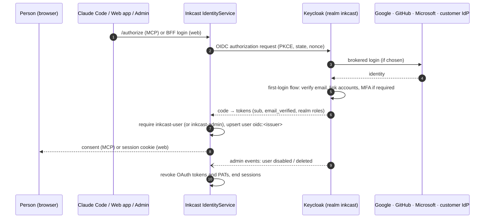

# E9 Identity on Keycloak: design

**Why now:** the web app (E4), the admin portal (E6) and SaaS self sign-up all depend on it. **Refined 2026-10-18:** authorization moved to OpenFGA ([docs/authorization.md](../../authorization.md)). Keycloak Organizations are tenants (`organization:<id>`); every account gets a personal organization; membership changes sync into OpenFGA tuples, with a scheduled reconcile ([ADR-0008](../../adr/0008-keycloak-openfga-sync.md)). The decision is [ADR-0006](../../adr/0006-identity-on-keycloak.md): Keycloak decides *who you are*; Inkcast decides *what a client or token may do*.

## Use cases

| Actor | Story |
|---|---|
| New writer | Signs up with Google, GitHub, Microsoft or email; verifies their email; lands in Inkcast with a workspace |
| Returning writer | Signs in with any linked login. Adding GitHub to a Google account links them, not a second user |
| Claude Code user | `/mcp` → browser → Keycloak (already signed in, so no prompt) → Inkcast consent → connected |
| Enterprise customer | Staff with `@acme.com` emails are sent to Acme's Entra ID or Okta (Keycloak Organizations) |
| Operator | Signs in to the admin portal with the `inkcast-admin` role and MFA |
| Security | Disabling a user in Keycloak cuts off their web, API, MCP and personal-access-token access within a minute |

## System design

### Realm as code (`deploy/keycloak/realm-inkcast.json`)

| Area | Setting |
|---|---|
| Registration | on, email as username, verify email, terms-and-conditions required action |
| Identity providers | `google`, `github`, `microsoft`, with secrets from Kubernetes Secrets, never in Git; first-broker-login links by verified email |
| Clients | `inkcast-identity` (confidential: Claude Code sign-in), `inkcast-web` (confidential BFF, E4), `inkcast-mobile` (public, PKCE, later) |
| Roles | `inkcast-user` (default role for every account), `inkcast-admin` (operators only; OTP or WebAuthn required) |
| Protection | brute-force detection, password policy, refresh-token rotation, short access tokens |
| Organizations | per enterprise customer: domains → their IdP |
| Events | admin events on; delivered to Inkcast (webhook SPI or polling the admin events API) |

### Inkcast changes

- **Allow-list of issuers:** `oidc:<issuer>#` stays the user key, and a realm migration can't silently create duplicates.
- **Identity and membership sync (F9.5):** an `IdentitySync` worker consumes Keycloak user and Organization events.
  - Membership and admin changes become OpenFGA tuples.
  - A disabled or deleted user loses all tokens **and tuples**, and sign-in is refused.
  - A scheduled reconcile removes access even when an event was missed.
- **Admin portal (E6):** it lists Inkcast users joined with their Keycloak linked identities, read through the Keycloak admin API with a dedicated service account.

## Stories

The full list is in [`../../backlog/E9-identity-on-keycloak.yaml`](../../backlog/E9-identity-on-keycloak.yaml):
1. The realm export, plus a kind CI job running a real Keycloak with it. The end-to-end sign-in test passes against real Keycloak, in single and split mode.
2. Self sign-up end to end (registration, email verification, default role).
3. Social identity providers and account linking (configuration plus a documented manual verification, since CI can't use real Google).
4. MFA for `inkcast-admin`; the admin client requires it.
5. User sync: disabling in Keycloak revokes Inkcast access (test with real Keycloak).
6. Organizations for enterprise SSO (one test organization brokered to a second Keycloak realm in CI).
7. Runbook: realm upgrades, key rotation, backup and restore.

## Risks

- **Keycloak is a critical dependency.** Run it highly available (two or more replicas on Postgres) in production. Existing MCP and PAT tokens keep working during a Keycloak outage; only new sign-ins fail.
- **Account linking by email** is only safe with verified emails. The realm requires verification before linking.

---
<!-- inkcast-nav -->
[Docs](../../README.md) · [Licensing](../../../LICENSING.md) · [Legal](../../../legal/README.md) · [Contributing](../../../CONTRIBUTING.md) · [Security](../../../SECURITY.md) · [Inkcast README](../../../README.md)
