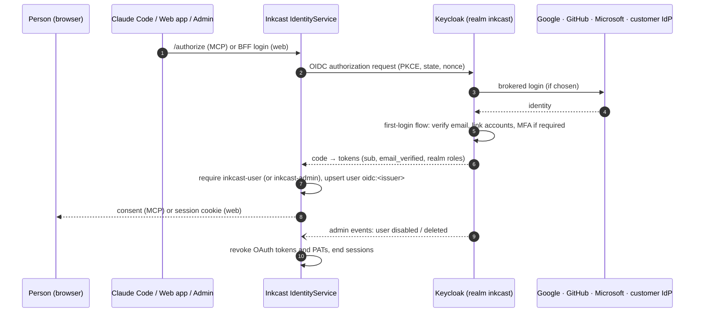

# E9 Identity on Keycloak: design

**Why now:** the web app (E4), the admin portal (E6) and SaaS self sign-up all depend on it. **Refined 2026-10-18:** authorization moved to OpenFGA ([docs/authorization.md](../../authorization.md)). Keycloak Organizations are tenants (`organization:<id>`); every account gets a personal organization; membership changes sync into OpenFGA tuples, with a scheduled reconcile ([ADR-0008](../../adr/0008-keycloak-openfga-sync.md)). The decision is [ADR-0006](../../adr/0006-identity-on-keycloak.md): Keycloak decides *who you are*; Inkcast decides *what a client or token may do*.

## Use cases

| Actor | Story |
|---|---|
| New writer | Signs up with Google, GitHub, Microsoft or email; verifies their email; lands in Inkcast with a workspace |
| Returning writer | Signs in with any linked login. Adding GitHub to a Google account links them, not a second user |
| Claude Code user | `/mcp` → browser → Keycloak (already signed in, so no prompt) → Inkcast consent → connected |
| Enterprise customer | Staff with `@acme.com` emails are sent to Acme's Entra ID or Okta (Keycloak Organizations) |
| Operator | Signs in to the admin portal with the `inkcast-admin` role and MFA |
| Security | Disabling a user in Keycloak cuts off their web, API, MCP and personal-access-token access within a minute |

## System design

### Realm as code (`deploy/keycloak/realm-inkcast.json`)

| Area | Setting |
|---|---|
| Registration | on, email as username, verify email, terms-and-conditions required action |
| Identity providers | `google`, `github`, `microsoft`, with secrets from Kubernetes Secrets, never in Git; first-broker-login links by verified email |
| Clients | `inkcast-identity` (confidential: Claude Code sign-in), `inkcast-web` (confidential BFF, E4), `inkcast-mobile` (public, PKCE, later) |
| Roles | `inkcast-user` (default role for every account), `inkcast-admin` (operators only; OTP or WebAuthn required) |
| Protection | brute-force detection, password policy, refresh-token rotation, short access tokens |
| Organizations | per enterprise customer: domains → their IdP |
| Events | admin events on; delivered to Inkcast (webhook SPI or polling the admin events API) |

### Inkcast changes

- **Allow-list of issuers:** `oidc:<issuer>#` stays the user key, and a realm migration can't silently create duplicates.
- **Identity and membership sync (F9.5):** an `IdentitySync` worker consumes Keycloak user and Organization events.
  - Membership and admin changes become OpenFGA tuples.
  - A disabled or deleted user loses all tokens **and tuples**, and sign-in is refused.
  - A scheduled reconcile removes access even when an event was missed.
- **Admin portal (E6):** it lists Inkcast users joined with their Keycloak linked identities, read through the Keycloak admin API with a dedicated service account.
- **Delete my account (F9.5.S4, issue #41): Inkcast leads, Keycloak deletes, Inkcast erases.** Inkcast holds no admin right over users: in Keycloak 26.6.1 deleting a user needs the fine-grained-permissions `manage` scope, which also allows changing the email, adding a federated identity, removing credentials and sending action emails, i.e. taking the account over; no delete-only grant exists. So the account is deleted by the person, through Keycloak's `delete_account` **application-initiated action** (AIA): Inkcast's page (reached from the `inkcast_delete_account` tool or `POST /api/v1/account/deletion-link`, after a fresh sign-in) says what goes and what stays, and its Continue sends the browser to the authorization endpoint with `kc_action=delete_account` through the ordinary `inkcast-identity` client, with state and PKCE as a sign-in. Keycloak always re-authenticates for this action, asks the person to confirm, and deletes.
  - **What Keycloak 26.6.1 does afterwards, read from its source** (`DeleteAccount.processAction`, `LoginActionsService.processRequireAction`, `AuthenticationManager.setKcActionStatus`, `OIDCLoginProtocol.authenticated` and `sendError`, `info.ftl`): on success it fires the `DELETE_ACCOUNT` user event, removes the authentication session and shows its own "User deleted successfully" page; it **never redirects back with `kc_action_status=success`** (there is no user left to issue a code for). Cancel (`cancel-aia`) redirects with `kc_action=delete_account&kc_action_status=cancelled`; a failed delete redirects with `error=access_denied`; an unsupported or disabled action with `kc_action_status=error`. The "deleted" page shows a "Back to Application" link only when the client has a `baseUrl`.
  - **So the realm sets the client's `baseUrl` to `/account/return`**, a neutral page unless the visit carries a pending-deletion cookie (Keycloak shows the same "Back to Application" link after an email verification or a password reset too), enables the `delete_account` required action, puts the `account` client's `delete-account` role into `default-roles-inkcast` (the person must hold it) and adds `DELETE_ACCOUNT` to `enabledEventTypes`. The account console's own "Delete account" is an accepted side effect.
  - **The visit back is matched, then confirmed, then erased.** Before redirecting, Inkcast keeps a pending-deletion record (user id, Keycloak `sub`, 30 minutes) and sets an HttpOnly, SameSite=Lax, path `/account` cookie whose hash is stored. On `GET /account/return` it finds the record by the cookie, asks the user sync's read-only `view-users` whether the person is gone (`GET users/{sub}` answers 404), and only then runs `Store.erase_user` (`via=return`, counted only when this visit erased rows: the record outlives the erasure, so a person whose data the backstop already erased still sees "deleted"); the record then goes, with the cookie. A visit while Keycloak still has the user erases nothing and says nothing was deleted (the record stays for a later confirmation); one while Keycloak does not answer erases nothing and says the deletion is being finished; a visit with no cookie, or with one no pending deletion matches (forged, left over), is the neutral page. Expired records are purged with the other expired identity rows.
  - **Backstop:** the sync reads `DELETE_ACCOUNT` user events with a cursor of its own (`keycloak-user-events`, beside the admin-events one) and erases those people (`via=event`); that also covers deletions from the account console. The sync's service account keeps `view-users` and `view-events` only. Because Inkcast can learn that an account is gone only through the sync, the deletion link is refused until `INKCAST_KEYCLOAK_SYNC_CLIENT_ID` is set.
  - Erasure is E3.F3.3.S5's `erase_user`: every table in one transaction, scheduled posts can never send afterwards, the outbox purged, an audit row with a salted hash of the id, the time and the counts. Token, code and PAT lookups refuse a person whose row is gone, so a sign-in finishing in the instant of an erasure gives nothing. Event `identity.user.deleted` (ids and counts only); metric `inkcast_identity_users_deleted_total{via}`.

## Stories

The full list is in [`../../backlog/E9-identity-on-keycloak.yaml`](../../backlog/E9-identity-on-keycloak.yaml):
1. The realm export, plus a kind CI job running a real Keycloak with it. The end-to-end sign-in test passes against real Keycloak, in single and split mode.
2. Self sign-up end to end (registration, email verification, default role).
3. Social identity providers and account linking (configuration plus a documented manual verification, since CI can't use real Google).
4. MFA for `inkcast-admin`; the admin client requires it.
5. User sync: disabling in Keycloak revokes Inkcast access (test with real Keycloak); deleting the account through Keycloak's `delete_account` action erases the person (F9.5.S4).
6. Organizations for enterprise SSO (one test organization brokered to a second Keycloak realm in CI).
7. Runbook: realm upgrades, key rotation, backup and restore.

## Risks

- **Keycloak is a critical dependency.** Run it highly available (two or more replicas on Postgres) in production. Existing MCP and PAT tokens keep working during a Keycloak outage; only new sign-ins fail.
- **Account linking by email** is only safe with verified emails. The realm requires verification before linking.

---
<!-- inkcast-nav -->
[Docs](../../README.md) · [Licensing](../../../LICENSING.md) · [Legal](../../../legal/README.md) · [Contributing](../../../CONTRIBUTING.md) · [Security](../../../SECURITY.md) · [Inkcast README](../../../README.md)
