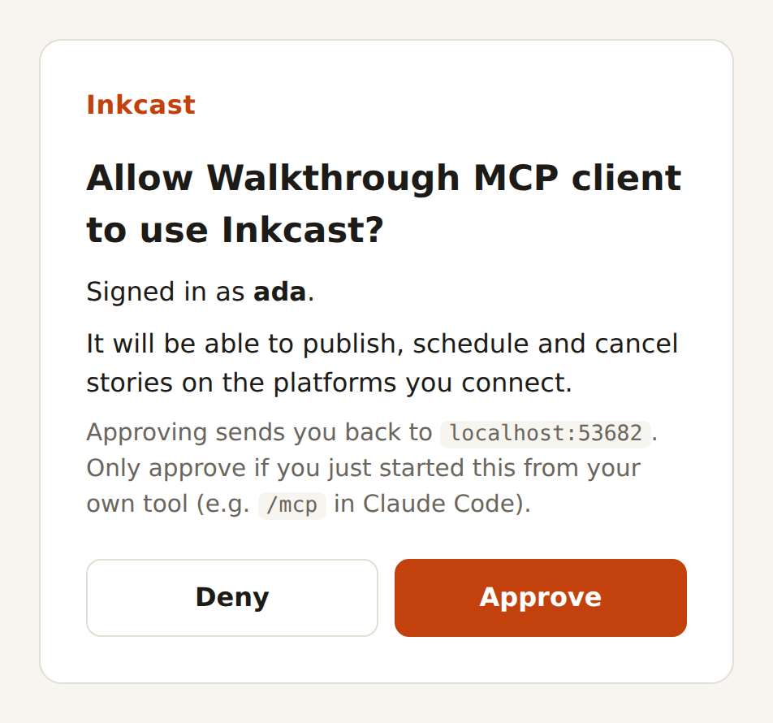
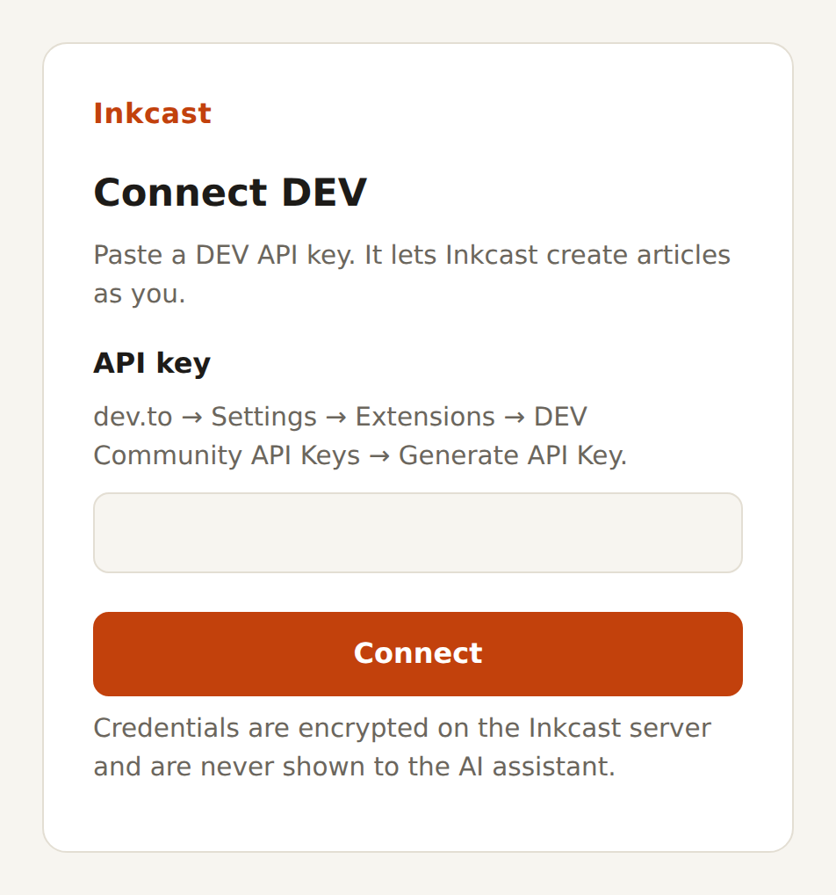
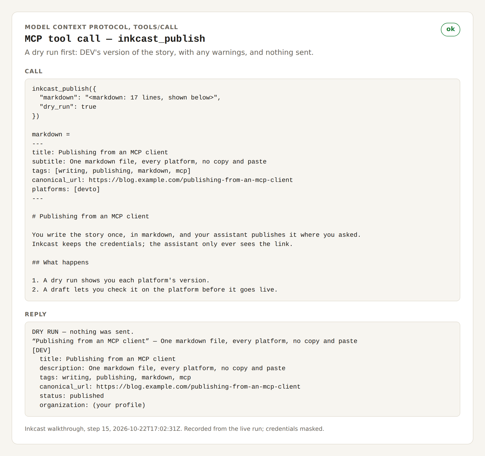
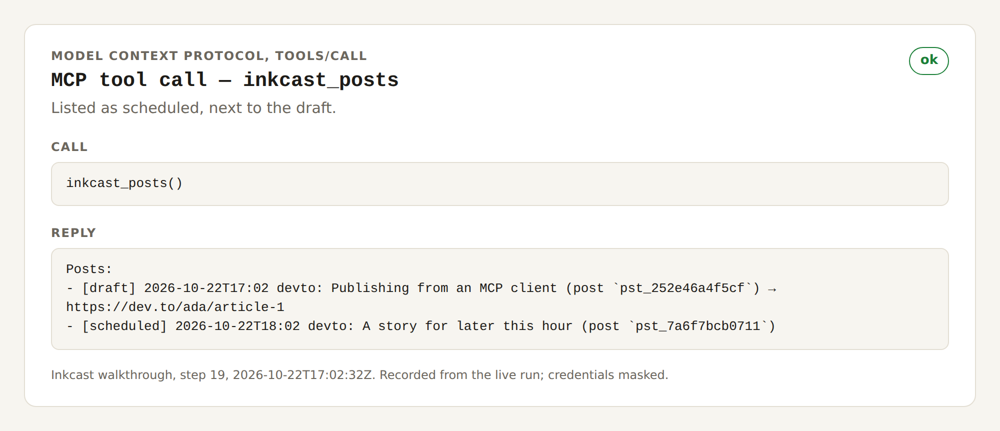
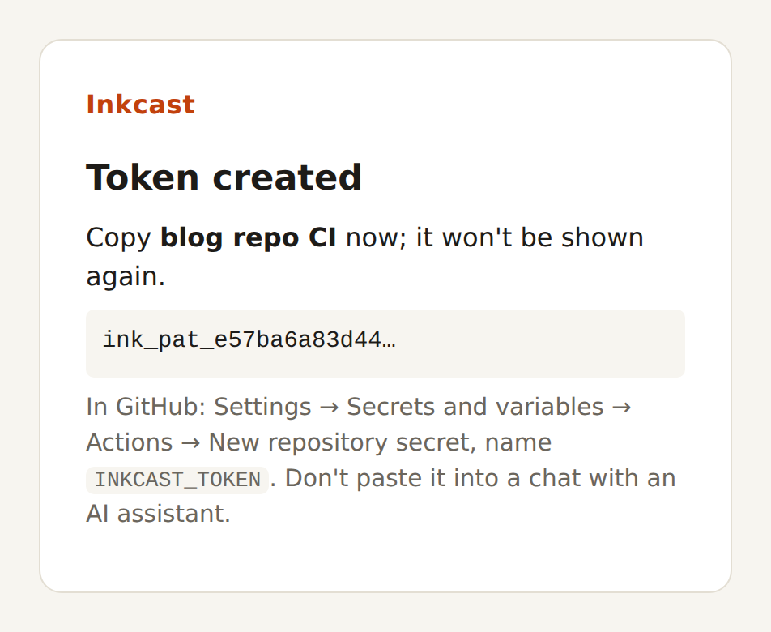
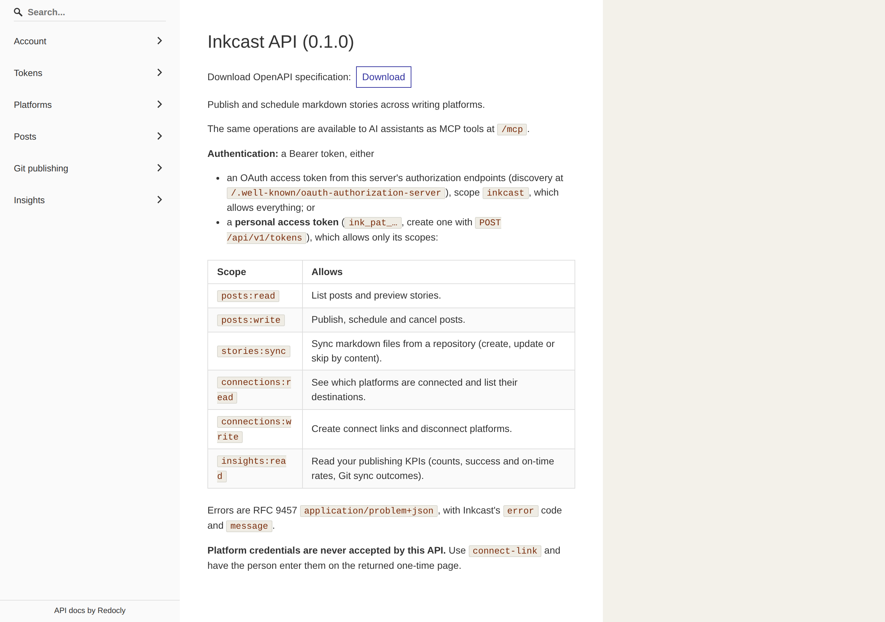
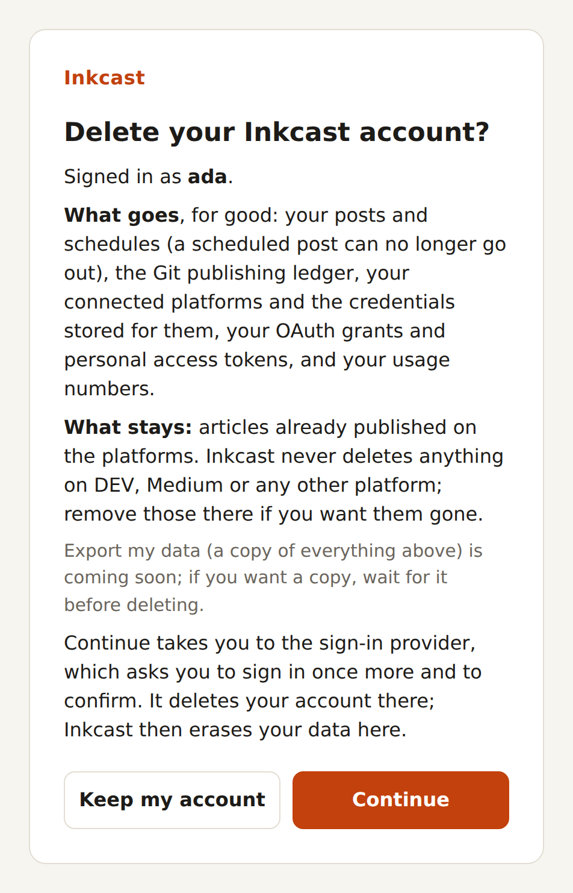
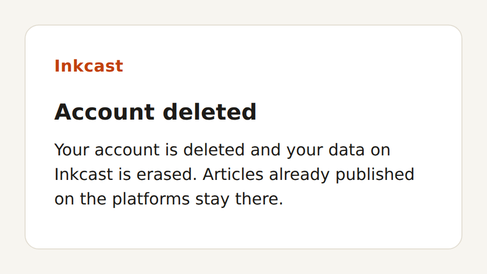

# Screenshots

A few pictures of Inkcast in use, in the order a person meets them. They come from the [end-to-end walkthrough](walkthrough.md), which drives the whole journey for real (an MCP client, a browser, the REST API) and checks every step; the panels are labelled MCP tool calls, not any client's interface.

From the run at commit `e7580fa73c1e` on 2026-10-22. The full walkthrough, every step pictured, is on the [`ci-captures`](https://github.com/inkcasthq/inkcast/tree/ci-captures/walkthrough/latest) branch, rebuilt by CI on every merge. Refresh this page with `python3 scripts/docs/showcase.py --from <walk output>`.

## 1. Add Inkcast to your AI assistant

Any MCP client signs in with OAuth (discovery, dynamic registration, PKCE). The person sees who is asking and what it will be able to do, and approves it in the browser.

## 2. Connect a platform, without the key going through chat

The assistant hands over a one-time link; the API key is pasted into Inkcast's own page, encrypted on the server, and never shown to the assistant.

## 3. A dry run first

One markdown file with front matter. The dry run shows each platform's version of the story and any warnings; nothing is sent.

## 4. Drafts and schedules

A draft on DEV to check before it goes live, next to a post scheduled for later in the hour (which can still be cancelled).

## 5. A token for publishing from Git

A personal access token for the blog repository's GitHub Action, scoped and shown once (masked here).

## 6. The REST API reference

Every deployment serves its OpenAPI reference at /api/redoc, with Swagger UI at /api.

## 7. Delete my account

What goes and what stays, stated before anything happens. The sign-in provider asks for the password again and confirms; Inkcast then erases the person's data.

## 8. Deleted

Every token stops working at once; articles already published stay on the platforms.

---
<!-- inkcast-nav -->
[Docs](README.md) · [Licensing](../LICENSING.md) · [Legal](../legal/README.md) · [Contributing](../CONTRIBUTING.md) · [Security](../SECURITY.md) · [Inkcast README](../README.md)
