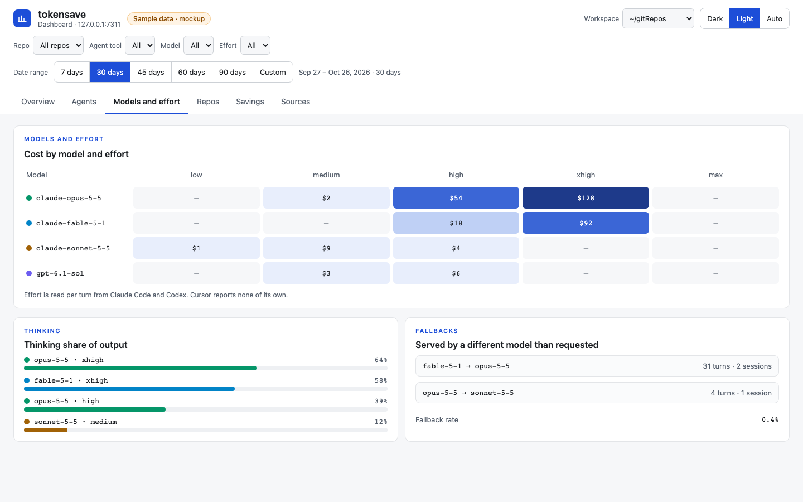

# tokensave fork: workspaces, agent and model discovery, and a local token dashboard

*Design for issue #227. Developer tooling, not part of Inkcast itself: it is built in the owner's fork of tokensave, and records how we measure the tokens our AI agents spend building Inkcast and every other repo. Mockups follow the [mockup standard](../mockup-standard.md) ([ADR-0016](../../adr/0016-mockup-standard-and-frontend-targets.md)).*

Developer tooling for building Inkcast (and every other repo) with AI coding agents. It's built in the owner's fork of [tokensave](https://github.com/aovestdipaperino/tokensave) (MIT), as new `tokensave` commands. The design lets them be proposed upstream later.

## The prompt, refined

> Add to tokensave a **workspace**: a parent folder that holds many repos, for example `~/gitRepos/<repoA…repoZ>`. Also add a **local dashboard** that shows, for every repo in the workspace:
> - the tokens our AI agents spent;
> - the tokens tokensave saved;
> - which agent, model and effort did the work.
>
> `tokensave init` discovers the workspace from the repo it runs in, or takes `--workspace <path>`. It can switch the dashboard on (`--enable-dashboard`) at once or later.
>
> Discovery is automatic throughout:
> - repos are found by scanning the workspace and reading tokensave's own registry;
> - agent tools are found by their local session data (Claude Code, Codex, Cursor, plus Pi and Factory Droid, which tokensave already reads);
> - subagents and their roles come from each tool's own records.
>
> Everything stays local and read-only: counts and names, never the content of prompts or files.

## What already exists (tokensave 7.16, read from source)

tokensave keeps one machine-wide database, `~/.tokensave/global.db`:

| Table | What it holds |
|---|---|
| `projects` | Every repo tokensave has served (`path`, `tokens_saved`). This is the repo registry. |
| `savings_ledger` | One row per tokensave MCP call: `ts`, `project_path`, `tool_name`, `before_tokens`, `after_tokens`. |
| `turns` | One row per agent turn, parsed incrementally from session logs (`parse_offsets`): `project_hash`, `session_id`, `model`, `timestamp`, `input_tokens`, `output_tokens`, `cache_write_tokens`, `cache_read_tokens`, `tool_result_tokens`, `cost_usd` (embedded price table), `credits`, `category` (13 task kinds: coding, debugging, feature-dev, refactoring, testing, exploration, planning, delegation, git-ops, build-deploy, brainstorming, conversation, general), `tool_names`, `agent`. |

- **Sources parsed today:** Claude Code (`~/.claude/projects/**/*.jsonl`), Pi, Factory Droid. **Not** Codex, not Cursor.
- **Fields Claude Code's logs carry that `turns` doesn't keep yet:**
  - `effort` / `perTurnEffort` (e.g. `high`, `xhigh`);
  - `requestedModel` against the model that served the turn, which shows fallbacks;
  - `usage.output_tokens_details.thinking_tokens`;
  - `thinkingDurationMs`;
  - `usage.speed` and `usage.service_tier`;
  - `gitBranch`;
  - `isSidechain` and `agentId`.
- **Subagents** have their own `subagents/agent-*.jsonl` plus `agent-*.meta.json`, which holds `agentType`, `description`, `model`, `effort`, `spawnDepth`, `finished`, `worktreeBranch`. The parent's `Agent` tool call carries `subagent_type`, `model`, `effort` and `description`.

## Concepts

- **Workspace:** a folder whose direct children are repos. It's marked by `.tokensave-workspace.toml` at its root. There can be several workspaces per machine.
- **Repo:** a child folder with `.git`. It counts as *indexed* when it also has `.tokensave/`.
- **Agent tool:** Claude Code, Codex, Cursor, Pi or Factory Droid, found by its local data folder.
- **Agent run:** a top-level session, or a subagent inside it, with a role. The role is the subagent type and description, e.g. "builder", "reviewer" or "Explore".
- **One dashboard per machine:** it serves every workspace on one port, so workspaces never fight over ports.

## Discovery

**1. Workspace from a repo,** first match wins:
1. `--workspace <path>`;
2. `TOKENSAVE_WORKSPACE`;
3. walking up to the nearest folder that holds `.tokensave-workspace.toml`;
4. if none, the repo's parent folder is proposed and created on confirmation (`--yes` skips the question).

**2. Repos in a workspace:** scan its direct children for `.git` (depth, include and exclude come from the workspace file). Merge that with `projects` in `global.db`. Repos outside any workspace appear under "Other".

**3. Agent tools,** by data folder. Each source is an adapter that turns its records into the same turn shape.

| Tool | Local data | What it gives | Status |
|---|---|---|---|
| Claude Code | `~/.claude/projects/<slug>/*.jsonl`, `subagents/*.jsonl` and `*.meta.json` | everything above, incl. effort, requested vs served model, thinking tokens, subagent role | parsed today; extend for the new fields |
| Codex CLI | `~/.codex/sessions/YYYY/MM/DD/rollout-*.jsonl` | `session_meta` (cwd, git branch, subagent parent), `turn_context` (model, effort), one `token_usage_record` per response (input including cached, cached, output including reasoning) | built: #260 |
| Cursor | none locally: its local files hold no token counts (measured in #261); usage comes from the owner's Cursor account by `tokensave cursor sync` (Admin API with a Team key, else the Cursor login when switched on) | per request: model, input, output, cache read and write tokens, cost | #261 |
| Pi, Factory Droid | as tokensave parses them today | tokensave's current fields | parsed today |

- A source's version or format is checked when it's read. An unknown shape is reported on the Sources page, never guessed.
- Repos are matched to turns by the session's working folder (`cwd`), so turns land in the right repo whichever tool ran them. This is the same normalisation tokensave uses for `project_hash`.

## Commands

```
tokensave init [--workspace PATH] [--enable-dashboard] [--port N] [--yes]
    In a repo: index it (as today), find or create the workspace, register the repo.
tokensave workspace init [PATH]          make PATH (default: the parent folder) a workspace
tokensave workspace scan                 list repos: indexed / not indexed / not a git repo
tokensave workspace init-all [--dry-run] index every unindexed repo (asks first)
tokensave workspace sync-all             `tokensave sync` in every repo (after pulls)
tokensave dashboard enable [--port N] [--at-login]   on now, or later
tokensave dashboard disable | start | stop | status | open
tokensave sources                        agent tools found, last parsed, format status
tokensave doctor                         (extended) workspace found, port free, sources readable
```

## Config

**Workspace,** in `<workspace>/.tokensave-workspace.toml`:

```toml
[workspace]
name = "gitRepos"
scan_depth = 1
exclude = ["archive-*"]
[aliases]
"service-a-long-name" = "service-a"
```

**Machine,** in `~/.tokensave/dashboard.toml`:

```toml
[dashboard]
enabled = true
port = 7311          # below Linux's ephemeral range; refuses to start if busy
bind = "127.0.0.1"   # local only
at_login = false     # true installs a launchd agent (macOS)
workspaces = ["~/gitRepos"]
[sources]            # all on by default when found; off to hide
claude = true
codex = true
cursor = true
```

Environment variables override both files, and nothing breaks if neither file exists.

## Metrics

**Spend, per turn and every aggregate:**
- input, output, cache write and cache read tokens;
- thinking or reasoning tokens;
- tool-result tokens;
- cost (USD) and credits.

**Dimensions:**

| Group | Dimensions |
|---|---|
| Who and what | agent tool; model; requested model (and fallbacks); effort; speed and service tier |
| Where and when | repo; git branch; session; date |
| Agent run | subagent with role, `spawnDepth` and finished or not |
| Work | task category; tool names |

**Savings:**
- tokensave's before → after per call;
- saved tokens and saving rate, by repo and by tokensave tool;
- *missed* savings, the turns `tokensave discover` says a graph call could have replaced.

**Derived:**
- cache hit rate;
- cost per agent run and per role;
- effort mix (share of tokens per effort level);
- model mix;
- fallback rate (served ≠ requested);
- subagent share of spend;
- thinking share of output;
- the top sessions and runs by cost.

**Coverage:**
- which sources were found, last parsed, and their format status;
- repos not indexed.

## Dashboard layout

Local only (`127.0.0.1`), one page with tabs, dark by default with light and auto (see Theme and colours). Global filters: workspace, repo, agent tool, model, effort, date range.

1. **Overview**
   - tiles: tokens spent, cost, tokens saved, saving rate, cache hit rate;
   - a daily chart of spent against saved;
   - the mix of agent tools and of models;
   - the top 5 costly runs.
2. **Agents**
   - each session with its subagents nested under it: role, model, effort, tokens, cost, duration, finished;
   - cost by role (builder, reviewer, main, Explore…).
3. **Models and effort**
   - a model × effort grid of tokens and cost;
   - thinking share;
   - fallbacks.
4. **Repos**
   - per repo: spent, saved, saving rate, last activity, indexed or not;
   - unindexed repos with the exact command to fix them.
5. **Savings**
   - by tokensave tool;
   - missed savings by kind, from `discover`.
6. **Sources**
   - each agent tool: found or not, path, last parsed, turns, format status (verified, partial, or unknown).

## Frontend

**Preact + TypeScript** (owner's choice, 2026-10-26). It has the same code style as Inkcast's React web app (ADR-0004) at about 4 KB, so the section components and the `mockup-to-page` mapping are shared.

- **Code:** components are function components using `preact/hooks`, with JSX through `jsxImportSource: "preact"`. There is one component per `build-mockup` section type (`kpi-tiles`, `time-series`, `bar-list`, `row-list`, `heat-grid`, `card-grid`, `callout`, `segmented`, `app-header`). Types are shared with the API layer.
- **Build:** Vite with `@preact/preset-vite` writes static files (one JS bundle, `tokens.css`, `index.html`). The Rust binary embeds them at compile time and serves them itself, so there's no CDN and it works offline. Node is needed only to build: people who install tokensave never need it.
- **State:** the date range and filters live in the URL (`URLSearchParams` + `history.replaceState`); the theme lives in browser storage, wrapped in try/catch.
- **Data:** one typed `fetch` module per endpoint from the mockup's dataset contracts.
- **Tests:**
  - Vitest with `@testing-library/preact` for components;
  - contract tests for the endpoints;
  - Playwright for the screen-size, theme and screenshot checks, compared against the mockup.

## Date range

Every tab follows one date range, set in the header.

- **Presets:** 7, 30, 45, 60 and 90 days, always ending today. **30 days is the default** (`default_range = "30d"` in `dashboard.toml`, or `--range`).
- **Custom:** a From and To date picker. To can't be after today, From can't be after To, and the span is limited to the data tokensave holds. The picker follows the theme.
- **What follows the range:** the totals, the daily chart (one bar per day, with the axis dates following the range) and every list on every tab. The header always says the range in words, e.g. "Sep 27 – Oct 26, 2026 · 30 days".
- **Shareable:** the range lives in the page's address (`?range=45d` or `?from=2026-10-01&to=2026-10-26`), so a link or a refresh keeps it.
- **On a phone:** the presets stay visible as a row that scrolls sideways, and the chart scrolls inside its card for longer ranges.

## Theme and colours

**Three modes: Dark, Light and Auto. Dark is the default** (owner's choice, 2026-10-26).
- Auto follows the operating system (`prefers-color-scheme`) and switches live when the Mac changes appearance.
- The header has a Light / Dark / Auto switch. The choice is remembered per browser, and if the browser can't store it the page falls back to the configured default.
- The configured default is `theme = "dark"` in `~/.tokensave/dashboard.toml`, or `--theme` on `dashboard start`.

**Colours are tokens.**
- Every colour is a named CSS variable, defined once for light and once for dark. No colour is written into a component.
- Charts read the same tokens, so they switch with the page.
- An optional `accent = "#RRGGBB"` changes the accent only. A value that fails contrast against either theme is refused at start-up, with the setting named in the error.

| Token | Light | Dark | Used for |
|---|---|---|---|
| `bg` | `#F6F7F9` | `#0F1216` | page background |
| `surface` | `#FFFFFF` | `#171B21` | cards, tables |
| `border` | `#E3E5E8` | `#2A3038` | lines |
| `text` | `#1A1D21` | `#E6E8EB` | body text |
| `muted` | `#555E6B` | `#A1A9B4` | labels (≥ 4.5:1 on `surface` in both) |
| `accent` | `#1D4ED8` | `#93C5FD` | links, the active tab, selected controls |
| `series-spent` | `#1D4ED8` | `#60A5FA` | tokens spent |
| `series-saved` | `#D97706` | `#FBBF24` | tokens saved (bars ≥ 3:1 on `surface` in both) |
| `series-neutral` | `#475569` | `#94A3B8` | models and other single-series bars |
| `ok` fg/bg | `#14532D` / `#E7F6EC` | `#86EFAC` / `#12321F` | verified, finished, indexed |
| `warn` fg/bg | `#7C2D12` / `#FDEFE3` | `#FDBA74` / `#3A2414` | partial, not indexed, missed savings |
| `info` fg/bg | `#1E3A8A` / `#EEF2FF` | `#BFDBFE` / `#1B2A4A` | running, roles |
| `stop` fg/bg | `#7F1D1D` / `#FDECEC` | `#FCA5A5` / `#3A1717` | stopped |
| heat scale | `#E8EEFC` → `#1E3A8A` | `#1B2A4A` → `#93C5FD` | the model × effort grid; text flips to stay ≥ 4.5:1 |

**More colours: a category set.**
The text, icon and surface colours above stay as they are. On top of them, eight category colours mark *which* thing a row, bar or icon belongs to, in the style of Cargo's small coloured marks. They're used for bars, dots, icon tiles and legend swatches, never for body text.

| Token | Light | Dark | Default meaning |
|---|---|---|---|
| `cat-emerald` | `#059669` | `#10D49A` | builder role |
| `cat-sky` | `#0284C7` | `#38BDF8` | Codex |
| `cat-amber` | `#A16207` | `#E2A717` | Explore role, Pi |
| `cat-violet` | `#6D5DF0` | `#A5ADF8` | reviewer role, Cursor |
| `cat-coral` | `#C2410C` | `#F08A6C` | Claude Code |
| `cat-pink` | `#DB2777` | `#F472B6` | Factory Droid |
| `cat-teal` | `#0F766E` | `#2DD4BF` | other roles |
| `cat-slate` | `#475569` | `#94A3B8` | main session, "other" |

**Rules:**
- **Contrast:** every category colour is at least 3:1 on `surface` in both themes (measured 3.8–7.6 light, 6.5–9.3 dark).
- **Icon tiles:** a tile is the category colour at 12% (light) or 16% (dark) over `surface`, with the icon in the full colour. That's at least 3.25:1 light and 5.1:1 dark.
- **Fixed assignments:** agent tools and roles keep their colour on every tab. Models take the set in order of spend. Past eight items, the rest fold into `cat-slate` "other".
- **Never colour alone:** a colour never stands without its label, and legends name every colour.
- **Configurable:** `[colors]` in `dashboard.toml` can reassign a meaning to another category, but can't add a colour that hasn't passed the contrast test.
- **Eyebrow labels** (small, upper-case and letter-spaced above a section, e.g. "BY AGENT TOOL") use `accent`.

**Accessibility rules:**
- Spent and saved are blue and amber: they differ in lightness as well as hue, so they still read for colour-blind viewers.
- State is never shown by colour alone. Every badge carries its word.
- Text meets 4.5:1 and large numbers 3:1 in both themes. A contrast test checks every token pair in both themes, plus the accent override.
- Charts have text values: each bar has its number in a tooltip and in a table view.

**Print and screenshots** always use the light theme.

## Fits every screen

The dashboard resizes itself to the device. Nothing is pinched or zoomed, and the page never scrolls sideways.

| Width | Layout |
|---|---|
| Phone (< 640 px) | One column. The header keeps the logo and the theme switch; filters fold into a "Filters" sheet. Tabs become a sticky row that scrolls sideways. Tiles go two per row. Tables become stacked cards, one card per row, with the key figure on top. |
| Tablet (640–1024 px) | Two columns of panels; tables stay tables and scroll inside their own box. |
| Desktop (1024–1440 px) | The full layout. |
| Wide (> 1440 px) | Content stays at 1440 px and centred. |

**Charts:**
- The daily chart keeps its full width.
- On a phone it defaults to 7 days, and 30 days scrolls inside the chart.
- The model × effort grid keeps its first column fixed while the effort columns scroll.

**Type and touch:**
- Headings and numbers scale with the screen (`clamp()`), and body text never drops below 14 px.
- Touch targets are at least 44 px.
- Phone notches and rounded corners are respected (safe areas).

**Behaviour:**
- Rotating the device, or resizing the window, reflows the page live.
- Reduced-motion settings turn off chart animations.

**Checked in CI:** Playwright opens every tab at 390, 768, 1024 and 1440 px and checks that the page width equals the screen width, with no sideways scroll. Light and dark screenshots are kept as artifacts.

## Stories, in order

1. **S1, data:**
   - store the new Claude Code fields: effort, requested model, thinking tokens, thinking time, speed, service tier, git branch, run id, subagent role, spawn depth;
   - add a migration for `turns` and a new `agent_runs` table from the `.meta.json` files;
   - write tests against fixture logs.
2. **S2, workspace:** `.tokensave-workspace.toml`; discovery from a repo; `workspace init/scan/init-all/sync-all`; `init --workspace`.
3. **S3, dashboard server and page (Preact + TypeScript, built by Vite, embedded in the binary):**
   - `dashboard enable/start/stop/status/open`;
   - one port per machine and a refusal when it's busy;
   - read-only queries on `global.db`;
   - the embedded page with the six tabs;
   - the theme tokens with Light / Dark / Auto and the contrast test;
   - `--at-login` via launchd.
4. **S4, Codex adapter (#260):** one turn per `token_usage_record`, model and effort from the `turn_context` before it, cwd → repo; fixtures.
5. **S5, Cursor usage (#261):** `tokensave cursor sync`, from the Admin API or the owner's Cursor login; never in the hooks.
6. **S6, upstream:** propose S1–S3 to tokensave as a PR, with the adapters following.

## Acceptance

- **Discovery:** `tokensave init` inside `~/gitRepos/inkcast` finds or creates the `~/gitRepos` workspace. `--workspace` overrides it. `--enable-dashboard` works at init and later via `dashboard enable`.
- **Repo listing:** `workspace scan` lists every child repo with its status. `init-all --dry-run` shows what would be indexed.
- **Second workspace:** enabling the dashboard from a second workspace adds it to the running dashboard instead of starting another one.
- **Dashboard:** the six tabs above, filters, and numbers that match the database. Tests seed a fixture database and check each figure.
- **Date range:** the presets 7, 30 (default), 45, 60 and 90 days and a custom From/To range, kept in the address; every figure and list follows it.
- **Fits every screen:** every tab passes the no-sideways-scroll check at 390, 768, 1024 and 1440 px; on a phone, tables are cards and filters a sheet.
- **Theme:** Dark is the default; Auto follows the OS and switches live; the switch is remembered per browser; `theme` and `accent` in `dashboard.toml` are validated; every token pair passes the contrast test in both themes.
- **Sources:** the Sources tab lists each tool found, and an unknown format shows as such, never guessed.
- **Privacy:** nothing leaves the machine, the dashboard binds to `127.0.0.1`, and prompt or file content is never stored or shown. tokensave's upload counter is off by default in the fork, or one command turns it off (`tokensave disable-upload-counter`).
- **Missing data:** works with any source missing, and says which.

## Mockups

The mockup is one app (target `preact-ts`): every tab shares the theme, the date range and the filters. Dark is the product's default; the screenshots here are light, per the repo's rule for screenshots. The theme tokens page shows both themes' colours. Sample data, generic names.

| Tab | Screenshot |
|---|---|
| [Overview](mockups/overview.html) |  |
| [Agents](mockups/agents.html) |  |
| [Models and effort](mockups/models.html) |  |
| [Repos](mockups/repos.html) |  |
| [Savings](mockups/savings.html) |  |
| [Sources](mockups/sources.html) |  |
| [Theme tokens](mockups/theme-tokens.html) |  |
| Overview on a phone |  |

**Contract.** Every dataset in `Main.dc.html` carries its `GET /api/...` source and TypeScript type, and every section its `data-component` and `data-dataset` (mockup standard §4–§5, #262); `mockup-to-page` translates them into the page's `types.ts`, API and components.

**Source.** `mockups/source/` holds the design-canvas files: `Main.dc.html` is the app, and the `Tab*`, `Tablet` and `Phone` files open it on one tab or at one width. Regenerate the pages and check every variant with:

```
scripts/mockups/check.py docs/tooling/tokensave-dashboard/mockups/source/Main.dc.html --out /tmp/mockup-check --export docs/tooling/tokensave-dashboard/mockups
```

## Notes

- Built on the Mac: this cloud workspace can't build Rust (crates.io isn't reachable).
- The editable design canvas is linked from issue #227 (private to the owner).

---
<!-- inkcast-nav -->
[Docs](../../README.md) · [Licensing](../../../LICENSING.md) · [Legal](../../../legal/README.md) · [Contributing](../../../CONTRIBUTING.md) · [Security](../../../SECURITY.md) · [Inkcast README](../../../README.md)
