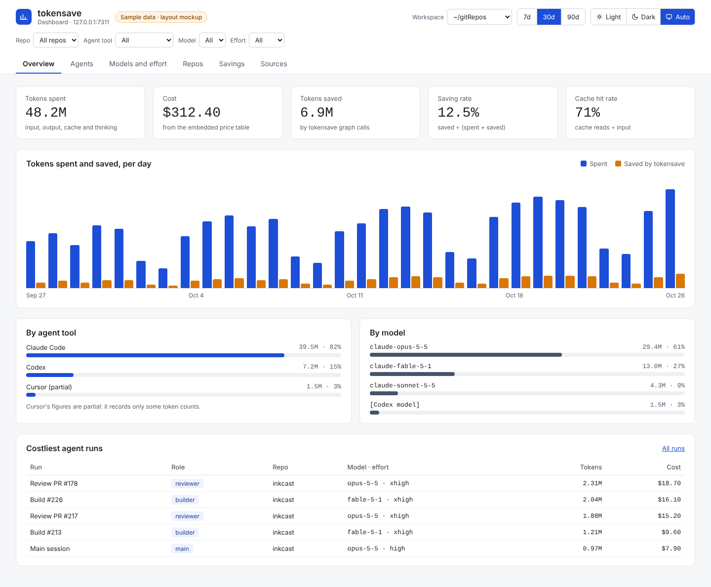
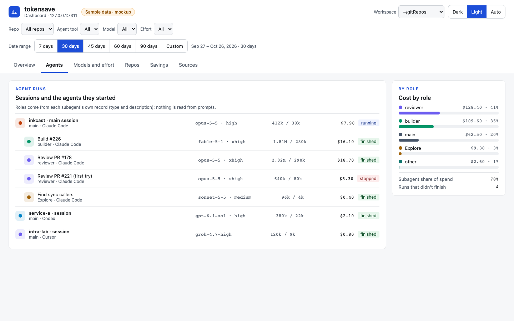
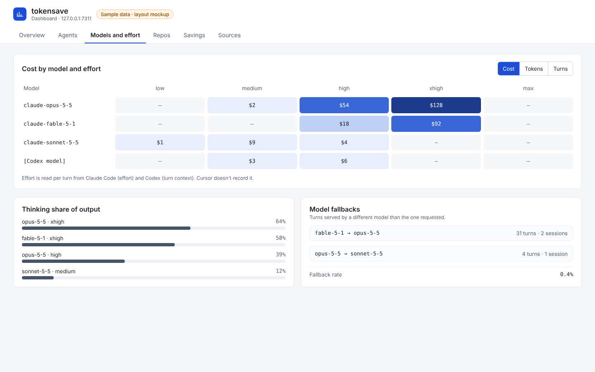
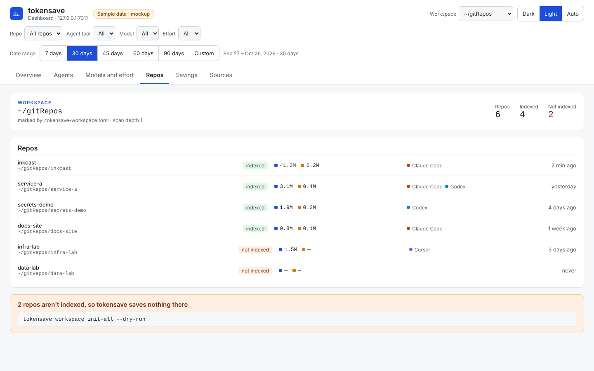
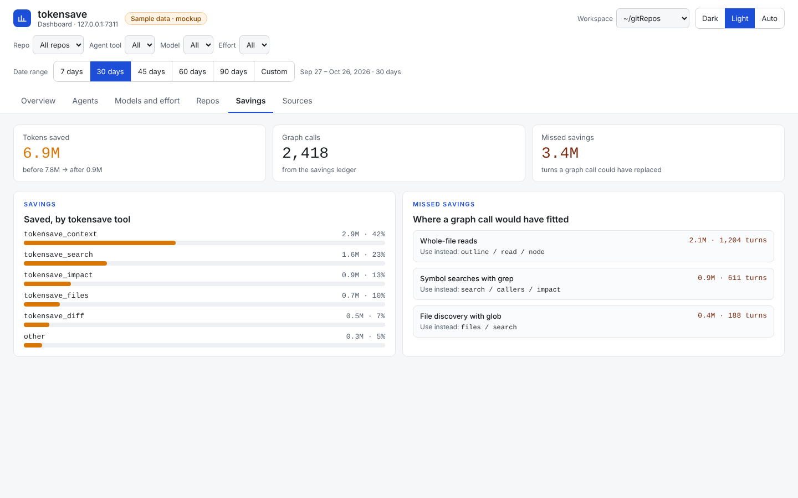
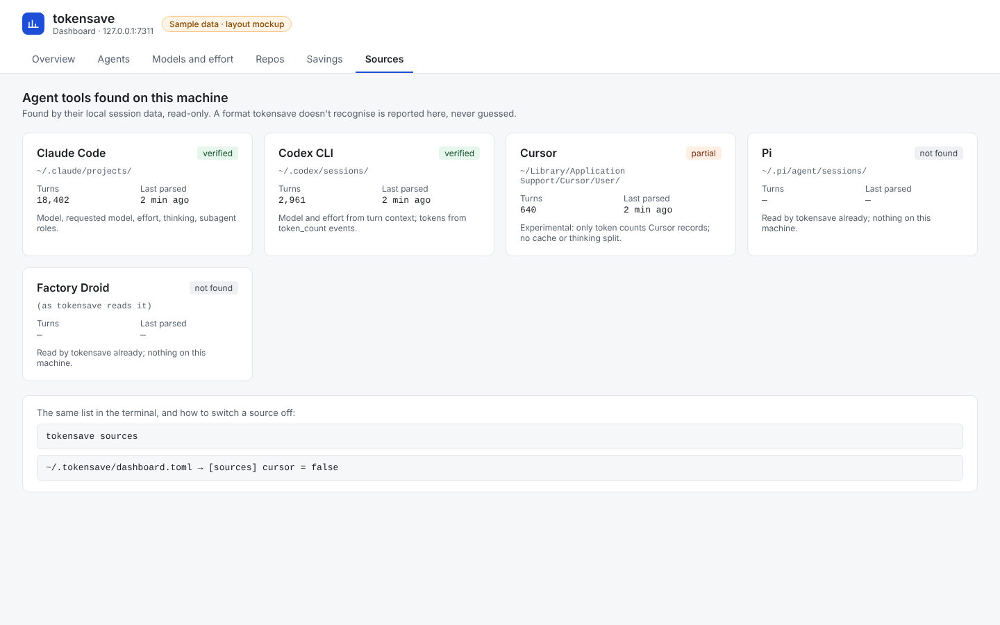
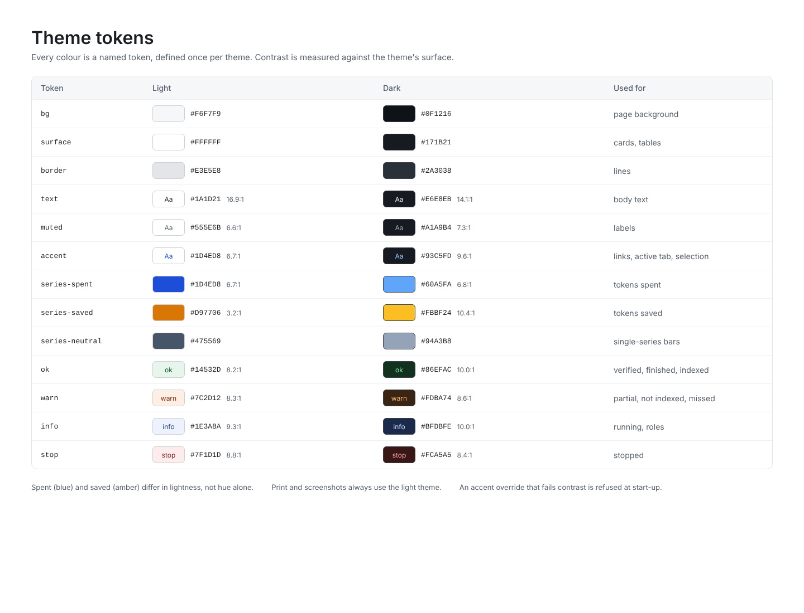
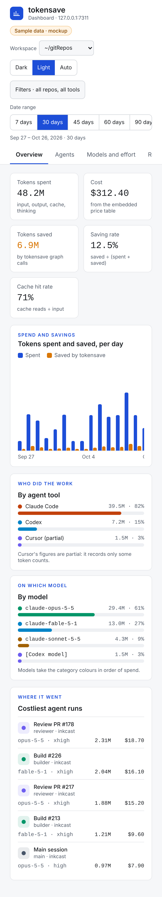

# tokensave fork: workspaces, agent and model discovery, and a local token dashboard

*Design for issue #227. Developer tooling, not part of Inkcast itself: it is built in the owner's fork of tokensave, and records how we measure the tokens our AI agents spend building Inkcast and every other repo.*

Developer tooling for building Inkcast (and every other repo) with AI coding agents. It's built in the owner's fork of [tokensave](https://github.com/aovestdipaperino/tokensave) (MIT), as new `tokensave` commands. The design lets them be proposed upstream later.

## The prompt, refined

> Add to tokensave a **workspace**: a parent folder that holds many repos, for example `~/gitRepos/<repoA…repoZ>`. Also add a **local dashboard** that shows, for every repo in the workspace:
> - the tokens our AI agents spent;
> - the tokens tokensave saved;
> - which agent, model and effort did the work.
>
> `tokensave init` discovers the workspace from the repo it runs in, or takes `--workspace <path>`. It can switch the dashboard on (`--enable-dashboard`) at once or later.
>
> Discovery is automatic throughout:
> - repos are found by scanning the workspace and reading tokensave's own registry;
> - agent tools are found by their local session data (Claude Code, Codex, Cursor, plus Pi and Factory Droid, which tokensave already reads);
> - subagents and their roles come from each tool's own records.
>
> Everything stays local and read-only: counts and names, never the content of prompts or files.

## What already exists (tokensave 7.16, read from source)

tokensave keeps one machine-wide database, `~/.tokensave/global.db`:

| Table | What it holds |
|---|---|
| `projects` | Every repo tokensave has served (`path`, `tokens_saved`). This is the repo registry. |
| `savings_ledger` | One row per tokensave MCP call: `ts`, `project_path`, `tool_name`, `before_tokens`, `after_tokens`. |
| `turns` | One row per agent turn, parsed incrementally from session logs (`parse_offsets`): `project_hash`, `session_id`, `model`, `timestamp`, `input_tokens`, `output_tokens`, `cache_write_tokens`, `cache_read_tokens`, `tool_result_tokens`, `cost_usd` (embedded price table), `credits`, `category` (13 task kinds: coding, debugging, feature-dev, refactoring, testing, exploration, planning, delegation, git-ops, build-deploy, brainstorming, conversation, general), `tool_names`, `agent`. |

- **Sources parsed today:** Claude Code (`~/.claude/projects/**/*.jsonl`), Pi, Factory Droid. **Not** Codex, not Cursor.
- **Fields Claude Code's logs carry that `turns` doesn't keep yet:**
  - `effort` / `perTurnEffort` (e.g. `high`, `xhigh`);
  - `requestedModel` against the model that served the turn, which shows fallbacks;
  - `usage.output_tokens_details.thinking_tokens`;
  - `thinkingDurationMs`;
  - `usage.speed` and `usage.service_tier`;
  - `gitBranch`;
  - `isSidechain` and `agentId`.
- **Subagents** have their own `subagents/agent-*.jsonl` plus `agent-*.meta.json`, which holds `agentType`, `description`, `model`, `effort`, `spawnDepth`, `finished`, `worktreeBranch`. The parent's `Agent` tool call carries `subagent_type`, `model`, `effort` and `description`.

## Concepts

- **Workspace:** a folder whose direct children are repos. It's marked by `.tokensave-workspace.toml` at its root. There can be several workspaces per machine.
- **Repo:** a child folder with `.git`. It counts as *indexed* when it also has `.tokensave/`.
- **Agent tool:** Claude Code, Codex, Cursor, Pi or Factory Droid, found by its local data folder.
- **Agent run:** a top-level session, or a subagent inside it, with a role. The role is the subagent type and description, e.g. "builder", "reviewer" or "Explore".
- **One dashboard per machine:** it serves every workspace on one port, so workspaces never fight over ports.

## Discovery

**1. Workspace from a repo,** first match wins:
1. `--workspace <path>`;
2. `TOKENSAVE_WORKSPACE`;
3. walking up to the nearest folder that holds `.tokensave-workspace.toml`;
4. if none, the repo's parent folder is proposed and created on confirmation (`--yes` skips the question).

**2. Repos in a workspace:** scan its direct children for `.git` (depth, include and exclude come from the workspace file). Merge that with `projects` in `global.db`. Repos outside any workspace appear under "Other".

**3. Agent tools,** by data folder. Each source is an adapter that turns its records into the same turn shape.

| Tool | Local data | What it gives | Status |
|---|---|---|---|
| Claude Code | `~/.claude/projects/<slug>/*.jsonl`, `subagents/*.jsonl` and `*.meta.json` | everything above, incl. effort, requested vs served model, thinking tokens, subagent role | parsed today; extend for the new fields |
| Codex CLI | `~/.codex/sessions/YYYY/MM/DD/rollout-*.jsonl` (newer builds `.jsonl.zst`), index `~/.codex/state_5.sqlite` | `session_meta` (cwd, model), `turn_context` (model, effort), `token_count` events (cumulative `input_tokens`, `cached_input_tokens`, `output_tokens`, reasoning tokens; per turn is the difference) | **new adapter**; field names verified against real files when built |
| Cursor | `state.vscdb` (SQLite) under the Cursor user folder; `globalStorage` and `workspaceStorage` | only explicit token counts where Cursor records them; no cache or reasoning split | **experimental**: not a public format, shown as partial |
| Pi, Factory Droid | as tokensave parses them today | tokensave's current fields | parsed today |

- A source's version or format is checked when it's read. An unknown shape is reported on the Sources page, never guessed.
- Repos are matched to turns by the session's working folder (`cwd`), so turns land in the right repo whichever tool ran them. This is the same normalisation tokensave uses for `project_hash`.

## Commands

```
tokensave init [--workspace PATH] [--enable-dashboard] [--port N] [--yes]
    In a repo: index it (as today), find or create the workspace, register the repo.
tokensave workspace init [PATH]          make PATH (default: the parent folder) a workspace
tokensave workspace scan                 list repos: indexed / not indexed / not a git repo
tokensave workspace init-all [--dry-run] index every unindexed repo (asks first)
tokensave workspace sync-all             `tokensave sync` in every repo (after pulls)
tokensave dashboard enable [--port N] [--at-login]   on now, or later
tokensave dashboard disable | start | stop | status | open
tokensave sources                        agent tools found, last parsed, format status
tokensave doctor                         (extended) workspace found, port free, sources readable
```

## Config

**Workspace,** in `<workspace>/.tokensave-workspace.toml`:

```toml
[workspace]
name = "gitRepos"
scan_depth = 1
exclude = ["archive-*"]
[aliases]
"service-a-long-name" = "service-a"
```

**Machine,** in `~/.tokensave/dashboard.toml`:

```toml
[dashboard]
enabled = true
port = 7311          # below Linux's ephemeral range; refuses to start if busy
bind = "127.0.0.1"   # local only
at_login = false     # true installs a launchd agent (macOS)
workspaces = ["~/gitRepos"]
[sources]            # all on by default when found; off to hide
claude = true
codex = true
cursor = true
```

Environment variables override both files, and nothing breaks if neither file exists.

## Metrics

**Spend, per turn and every aggregate:**
- input, output, cache write and cache read tokens;
- thinking or reasoning tokens;
- tool-result tokens;
- cost (USD) and credits.

**Dimensions:**

| Group | Dimensions |
|---|---|
| Who and what | agent tool; model; requested model (and fallbacks); effort; speed and service tier |
| Where and when | repo; git branch; session; date |
| Agent run | subagent with role, `spawnDepth` and finished or not |
| Work | task category; tool names |

**Savings:**
- tokensave's before → after per call;
- saved tokens and saving rate, by repo and by tokensave tool;
- *missed* savings, the turns `tokensave discover` says a graph call could have replaced.

**Derived:**
- cache hit rate;
- cost per agent run and per role;
- effort mix (share of tokens per effort level);
- model mix;
- fallback rate (served ≠ requested);
- subagent share of spend;
- thinking share of output;
- the top sessions and runs by cost.

**Coverage:**
- which sources were found, last parsed, and their format status;
- repos not indexed.

## Dashboard layout

Local only (`127.0.0.1`), one page with tabs, dark by default with light and auto (see Theme and colours). Global filters: workspace, repo, agent tool, model, effort, date range.

1. **Overview**
   - tiles: tokens spent, cost, tokens saved, saving rate, cache hit rate;
   - a daily chart of spent against saved;
   - the mix of agent tools and of models;
   - the top 5 costly runs.
2. **Agents**
   - each session with its subagents nested under it: role, model, effort, tokens, cost, duration, finished;
   - cost by role (builder, reviewer, main, Explore…).
3. **Models and effort**
   - a model × effort grid of tokens and cost;
   - thinking share;
   - fallbacks.
4. **Repos**
   - per repo: spent, saved, saving rate, last activity, indexed or not;
   - unindexed repos with the exact command to fix them.
5. **Savings**
   - by tokensave tool;
   - missed savings by kind, from `discover`.
6. **Sources**
   - each agent tool: found or not, path, last parsed, turns, format status (verified, partial, or unknown).

## Theme and colours

**Three modes: Dark, Light and Auto. Dark is the default** (owner's choice, 2026-10-26).
- Auto follows the operating system (`prefers-color-scheme`) and switches live when the Mac changes appearance.
- The header has a Light / Dark / Auto switch. The choice is remembered per browser, and if the browser can't store it the page falls back to the configured default.
- The configured default is `theme = "dark"` in `~/.tokensave/dashboard.toml`, or `--theme` on `dashboard start`.

**Colours are tokens.**
- Every colour is a named CSS variable, defined once for light and once for dark. No colour is written into a component.
- Charts read the same tokens, so they switch with the page.
- An optional `accent = "#RRGGBB"` changes the accent only. A value that fails contrast against either theme is refused at start-up, with the setting named in the error.

| Token | Light | Dark | Used for |
|---|---|---|---|
| `bg` | `#F6F7F9` | `#0F1216` | page background |
| `surface` | `#FFFFFF` | `#171B21` | cards, tables |
| `border` | `#E3E5E8` | `#2A3038` | lines |
| `text` | `#1A1D21` | `#E6E8EB` | body text |
| `muted` | `#555E6B` | `#A1A9B4` | labels (≥ 4.5:1 on `surface` in both) |
| `accent` | `#1D4ED8` | `#93C5FD` | links, the active tab, selected controls |
| `series-spent` | `#1D4ED8` | `#60A5FA` | tokens spent |
| `series-saved` | `#D97706` | `#FBBF24` | tokens saved (bars ≥ 3:1 on `surface` in both) |
| `series-neutral` | `#475569` | `#94A3B8` | models and other single-series bars |
| `ok` fg/bg | `#14532D` / `#E7F6EC` | `#86EFAC` / `#12321F` | verified, finished, indexed |
| `warn` fg/bg | `#7C2D12` / `#FDEFE3` | `#FDBA74` / `#3A2414` | partial, not indexed, missed savings |
| `info` fg/bg | `#1E3A8A` / `#EEF2FF` | `#BFDBFE` / `#1B2A4A` | running, roles |
| `stop` fg/bg | `#7F1D1D` / `#FDECEC` | `#FCA5A5` / `#3A1717` | stopped |
| heat scale | `#E8EEFC` → `#1E3A8A` | `#1B2A4A` → `#93C5FD` | the model × effort grid; text flips to stay ≥ 4.5:1 |

**Accessibility rules:**
- Spent and saved are blue and amber: they differ in lightness as well as hue, so they still read for colour-blind viewers.
- State is never shown by colour alone. Every badge carries its word.
- Text meets 4.5:1 and large numbers 3:1 in both themes. A contrast test checks every token pair in both themes, plus the accent override.
- Charts have text values: each bar has its number in a tooltip and in a table view.

**Print and screenshots** always use the light theme.

## Stories, in order

1. **S1, data:**
   - store the new Claude Code fields: effort, requested model, thinking tokens, thinking time, speed, service tier, git branch, run id, subagent role, spawn depth;
   - add a migration for `turns` and a new `agent_runs` table from the `.meta.json` files;
   - write tests against fixture logs.
2. **S2, workspace:** `.tokensave-workspace.toml`; discovery from a repo; `workspace init/scan/init-all/sync-all`; `init --workspace`.
3. **S3, dashboard server:**
   - `dashboard enable/start/stop/status/open`;
   - one port per machine and a refusal when it's busy;
   - read-only queries on `global.db`;
   - the embedded page with the six tabs;
   - the theme tokens with Light / Dark / Auto and the contrast test;
   - `--at-login` via launchd.
4. **S4, Codex adapter:** sessions → turns with model, effort, tokens per turn (cumulative differences), cwd → repo; `.jsonl` and `.jsonl.zst`; fixtures.
5. **S5, Cursor adapter (experimental):** explicit token counts only, marked partial; format check; can be switched off.
6. **S6, upstream:** propose S1–S3 to tokensave as a PR, with the adapters following.

## Acceptance

- **Discovery:** `tokensave init` inside `~/gitRepos/inkcast` finds or creates the `~/gitRepos` workspace. `--workspace` overrides it. `--enable-dashboard` works at init and later via `dashboard enable`.
- **Repo listing:** `workspace scan` lists every child repo with its status. `init-all --dry-run` shows what would be indexed.
- **Second workspace:** enabling the dashboard from a second workspace adds it to the running dashboard instead of starting another one.
- **Dashboard:** the six tabs above, filters, and numbers that match the database. Tests seed a fixture database and check each figure.
- **Theme:** Dark is the default; Auto follows the OS and switches live; the switch is remembered per browser; `theme` and `accent` in `dashboard.toml` are validated; every token pair passes the contrast test in both themes.
- **Sources:** the Sources tab lists each tool found, and an unknown format shows as such, never guessed.
- **Privacy:** nothing leaves the machine, the dashboard binds to `127.0.0.1`, and prompt or file content is never stored or shown. tokensave's upload counter is off by default in the fork, or one command turns it off (`tokensave disable-upload-counter`).
- **Missing data:** works with any source missing, and says which.

## Mockups

Light theme, sample data. Each page is a self-contained HTML file next to its screenshot, and the tabs link to each other. The dark theme's colours are on the theme tokens page; an editable design canvas with a dark Overview is linked from issue #227.

| Page | Screenshot |
|---|---|
| [Overview](mockups/overview.html) |  |
| [Agents](mockups/agents.html) |  |
| [Models and effort](mockups/models-and-effort.html) |  |
| [Repos](mockups/repos.html) |  |
| [Savings](mockups/savings.html) |  |
| [Sources](mockups/sources.html) |  |
| [Theme tokens](mockups/theme-tokens.html) |  |
| Overview on a phone |  |

## Notes

- Built on the Mac: this cloud workspace can't build Rust (crates.io isn't reachable).
- Sample repo names in the mockups are placeholders.
- The mockup HTML was made from the design canvas; the screenshots are Chromium at 1440 px (390 px for the phone).

---
<!-- inkcast-nav -->
[Docs](../../README.md) · [Licensing](../../../LICENSING.md) · [Legal](../../../legal/README.md) · [Contributing](../../../CONTRIBUTING.md) · [Security](../../../SECURITY.md) · [Inkcast README](../../../README.md)
